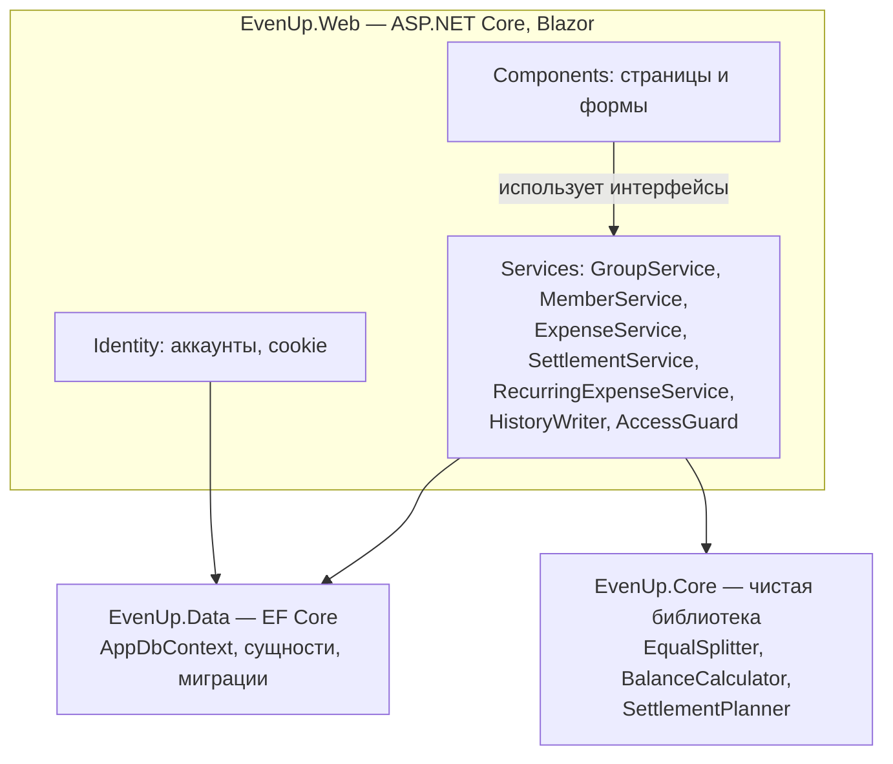
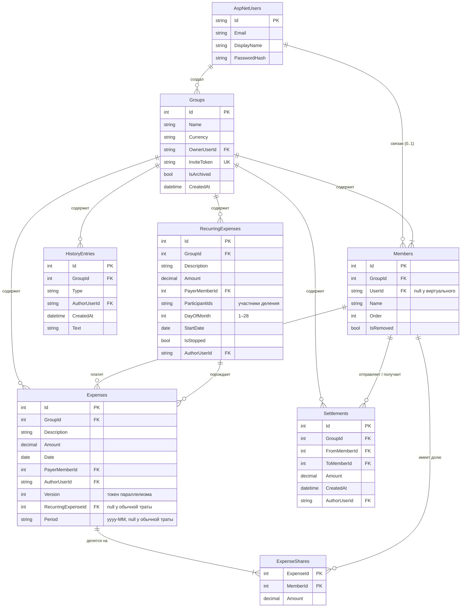

# Описание дизайна программного обеспечения

Для веб-приложения «EvenUp» — учёт совместных расходов

Версия 0.2

Подготовил(а) Чалей В. В.

БГУИР, кафедра ЭВМ

19.11.2026

## Оглавление

<!-- TOC -->
* [1. Введение](#1-introduction)
  * [1.1 Назначение документа](#11-document-purpose)
  * [1.2 Область применения](#12-subject-scope)
  * [1.3 Определения, акронимы и сокращения](#13-definitions-acronyms-and-abbreviations)
  * [1.4 Ссылки](#14-references)
  * [1.5 Обзор документа](#15-document-overview)
* [2. Обзор дизайна](#2-design-overview)
  * [2.1 Задачи стейкхолдеров](#21-stakeholder-concerns)
  * [2.2 Выбранные точки зрения](#22-selected-viewpoints)
* [3. Проектные представления](#3-design-views)
  * [3.1 Системные требования](#31-system-requirements)
  * [3.2 Приоритеты функционала](#32-feature-priorities)
    * [3.2.1 Оценки и план итераций](#321-estimates-and-iteration-plan)
  * [3.3 Представления дизайна](#33-views)
* [4. Решения](#4-decisions)
* [5. Приложения](#5-appendixes)
<!-- TOC -->

## История изменений

| Name | Date | Reason For Changes | Version |
|------|------|--------------------|---------|
| Чалей В. В. | 04.11.2026 | Первоначальная версия на основе SRS v0.1 | 0.1 |
| Чалей В. В. | 16.11.2026 | Оценки функций в часах и три версии плана итераций по итогам обсуждения с Заказчиком; F-10, F-14 и F-15 перенесены в релиз 2.0, добавлена F-16 «Регулярные траты» (SRS v0.3) | 0.2 |
| Чалей В. В. | 19.11.2026 | Сокращены проектные представления и обновлена трассировка требований для ЛР №4 | 0.2 |

---

## 1. Введение {#1-introduction}

Документ описывает, **как** будет устроено веб-приложение «EvenUp»: из каких частей состоит система, как хранятся данные, как работают ключевые алгоритмы и какие архитектурные решения приняты. Требования к системе («что» она делает) описаны в SRS, здесь они переводятся в системные требования и проектные элементы.

### 1.1 Назначение документа {#11-document-purpose}

SDD служит руководством для разработчиков при реализации релиза 1.0 и для сопровождающего при последующих изменениях. Документ также используется Заказчиком для согласования приоритетов функционала и плана реализации. Текущая база требований — [SRS v0.3](srs.md), решения описаны в протоколах [ADR](adr/).

### 1.2 Область применения {#12-subject-scope}

Документ описывает релиз 1.0: веб-интерфейс на Blazor, серверную бизнес-логику, SQLite и библиотеку расчётов. Система позволяет вести совместные траты и балансы, а также показывает план переводов, который закрывает долги не более чем за N − 1 переводов. Выбранный жадный алгоритм не гарантирует математически абсолютный минимум переводов.

**Входит:** требования релиза 1.0 из SRS и функции F-00…F-09, F-11…F-13, F-16 из раздела 3.2.

**Не входит в релиз 1.0:** детали траты (F-10), привязка виртуального участника (F-14) и фильтр трат (F-15) — перенесены в релиз 2.0 по согласованию с Заказчиком; экспорт истории в CSV, деление по долям и категории трат (отложены в SRS до релиза 2.0); реальные платежи, уведомления и нативные мобильные приложения.

### 1.3 Определения, акронимы и сокращения {#13-definitions-acronyms-and-abbreviations}

| Term | Definition |
|------|------------|
| ADR | Architectural Decision Record — протокол архитектурного решения |
| API | Application Programming Interface — набор определений и протоколов для создания и интеграции прикладного ПО |
| Circuit | Сеанс Blazor Interactive Server: состояние компонентов одного пользователя на сервере, связанное с браузером через SignalR |
| DI | Dependency Injection — внедрение зависимостей, встроенный механизм ASP.NET Core |
| DTO | Data Transfer Object — простой объект для передачи данных между слоями |
| EF Core | Entity Framework Core — ORM-библиотека .NET |
| ER | Entity-Relationship — модель «сущность-связь» |
| Member | Участник группы (обычный или виртуальный) |
| SDD | Software Design Document — документ, описывающий назначение, требования и характер ПО |
| Settlement | Погашение — запись о переводе денег между участниками |
| SignalR | Библиотека ASP.NET Core для двусторонней связи браузера и сервера (WebSocket) |
| SRS | Software Requirements Specification — спецификация требований к ПО |
| SYS | Префикс ID системного требования |

Остальные термины предметной области (баланс, доля, виртуальный участник и т.д.) определены в SRS, раздел 1.3.

### 1.4 Ссылки {#14-references}

| Документ | Владелец | Версия / дата | Расположение | Статус |
|----------|----------|---------------|--------------|--------|
| SRS «EvenUp» | Чалей В. В. | 0.3 / 16.11.2026 | `docs/design/srs.md` | Нормативная |
| Протоколы архитектурных решений | Чалей В. В. | 04.11.2026 | `docs/design/adr/` | Нормативная |
| Лабораторная работа №4 «Разработка и документирование системных требований» | Кафедра, дисциплина ЖЦРПО | 2026 | Выдаётся преподавателем | Нормативная |
| Шаблоны SDD и ADR | Кафедра, дисциплина ЖЦРПО | — | Выдаются преподавателем | Нормативная |
| Мокапы интерфейса (SysMLv2) | Чалей В. В. | 0.1 | `docs/design/sysml/`, `docs/design/images/` | Справочная |
| Документация ASP.NET Core Blazor | Microsoft | .NET 10 | https://learn.microsoft.com/aspnet/core/blazor | Справочная |
| Документация EF Core | Microsoft | 10.0 | https://learn.microsoft.com/ef/core | Справочная |

### 1.5 Обзор документа {#15-document-overview}

Раздел 2 описывает стейкхолдеров и выбранные точки зрения. Раздел 3 содержит системные требования, приоритеты и планы итераций, а также три представления, необходимые для их реализации: состав системы, модель данных и ключевые алгоритмы. Раздел 4 перечисляет архитектурные решения; полные записи находятся в `adr/`. При изменении документа добавляется строка в «Историю изменений», а изменённые системные требования получают суффикс версии (`SYS-FUNC-005-2`), как и в SRS.

---

## 2. Обзор дизайна {#2-design-overview}

Система — монолитное веб-приложение ASP.NET Core с интерфейсом Blazor в режиме Interactive Server. Весь код (интерфейс, логика, доступ к данным) выполняется на одном сервере, браузер получает только разметку и обновления через SignalR. Данные хранятся в одном файле SQLite. Расчётные алгоритмы вынесены в отдельную библиотеку без зависимостей от веба и базы данных, чтобы их было легко тестировать.

### 2.1 Задачи стейкхолдеров {#21-stakeholder-concerns}

| Стейкхолдер | Основные задачи | Где адресуется |
|-------------|-----------------|----------------|
| Пользователь (участник группы) | Правильные балансы, быстрый отклик, работа с телефона | 007-algorithms, SRS UI |
| Заказчик (партнёр по проекту) | Согласование состава функций и учебного графика | 3.1, 3.2, SRS |
| Разработчик (автор, один студент) | Разделение ответственности, целостность данных, ключевые расчёты и соблюдение учебных сроков | 002-composition, 004-information, 007-algorithms |
| Тестировщик | Трассировка требований в код и тесты | 3.1, Приложение А |
| Сопровождающий / преподаватель | Простая установка и запуск, отсутствие внешних сервисов | 002-composition, ADR-0002 |

### 2.2 Выбранные точки зрения {#22-selected-viewpoints}

Из 15 точек зрения шаблона выбраны те, которые непосредственно поддерживают системные требования и план реализации.

| Точка зрения | Используется | Представление | Язык |
|--------------|:-----------:|---------------|------|
| Композиция и зависимости | ✔ | 002-composition | Диаграмма компонентов и таблица ответственности |
| Информация | ✔ | 004-information | ER-диаграмма |
| Алгоритм | ✔ | 007-algorithms | Псевдокод ключевых расчётов |

---

## 3. Проектные представления {#3-design-views}

### 3.1 Системные требования {#31-system-requirements}

Системные требования получены из требований SRS и описывают, что должна обеспечить каждая часть системы. Формат ID: `SYS-[AREA]-[NNN]`. Колонка «Компонент» ссылается на представление 002-composition, колонка «Функция» — на функцию из раздела 3.2 (там же её приоритет и релиз).

#### 3.1.1 Функциональные системные требования

| ID | Требование | Из SRS | Компонент | Функция |
|----|------------|--------|-----------|---------|
| SYS-FUNC-001 | Система должна регистрировать пользователя через ASP.NET Core Identity, после подтверждения согласия сохранять email, отображаемое имя и хэш пароля и сразу выполнять вход | REQ-FUNC-001, REQ-SEC-001, REQ-SEC-007, REQ-COMP-002 | EvenUp.Web (Identity) | F-01 |
| SYS-FUNC-002 | Система должна выполнять вход по email и паролю, блокировать аккаунт на 5 минут после 5 неудачных попыток и перенаправлять неавторизованные запросы к защищённым страницам на `/login` | REQ-FUNC-002, REQ-SEC-006 | EvenUp.Web (Identity) | F-01 |
| SYS-FUNC-003 | `GroupService` должен создавать группу с названием и валютой, добавляя создателя первым участником (`Order = 0`) в одной транзакции | REQ-FUNC-003 | GroupService | F-02 |
| SYS-FUNC-004 | `GroupService` должен возвращать список групп пользователя с его балансом в каждой, разделяя активные и архивные группы | REQ-FUNC-004 | GroupService, BalanceCalculator | F-02 |
| SYS-FUNC-005 | `ExpenseService` должен сохранять трату вместе с долями в одной транзакции; доли рассчитываются `EqualSplitter` | REQ-FUNC-011, REQ-FUNC-012, REQ-REL-001 | ExpenseService, EqualSplitter | F-03 |
| SYS-FUNC-006 | `EqualSplitter` должен делить сумму на N долей с округлением вниз до 0,01 и раздавать остаток по 0,01 участникам с наименьшим `Order` | REQ-FUNC-012 | EvenUp.Core | F-03 |
| SYS-FUNC-007 | `BalanceCalculator` должен вычислять балансы участников по тратам, долям и погашениям группы при каждом запросе (баланс не хранится в БД) | REQ-FUNC-014 | EvenUp.Core | F-04 |
| SYS-FUNC-008 | `MemberService` должен добавлять виртуального участника с `UserId = null`, проверяя уникальность имени в группе и лимит 30 участников | REQ-FUNC-008, REQ-FUNC-021 | MemberService | F-05 |
| SYS-FUNC-009 | `GroupService` должен хранить токен приглашения (128 бит, `RandomNumberGenerator`, base64url) и перевыпускать его по запросу создателя | REQ-FUNC-006, REQ-SEC-004 | GroupService | F-06 |
| SYS-FUNC-010 | `MemberService` должен добавлять пользователя в группу по действующему токену; при повторном вступлении возвращать существующего участника, для архивной или заполненной группы — ошибку | REQ-FUNC-007, REQ-FUNC-021 | MemberService | F-06 |
| SYS-FUNC-011 | `SettlementPlanner` должен строить список переводов жадным алгоритмом не более чем из N − 1 переводов | REQ-FUNC-015 | EvenUp.Core | F-07 |
| SYS-FUNC-012 | `SettlementService` должен записывать и удалять погашения с проверкой прав (автор или создатель группы) и запретом совпадения отправителя и получателя | REQ-FUNC-016, REQ-FUNC-017 | SettlementService | F-08 |
| SYS-FUNC-013 | `ExpenseService` должен разрешать изменение и удаление траты только её автору и создателю группы; изменение пересчитывает доли | REQ-FUNC-013, REQ-SEC-002 | ExpenseService, AccessGuard | F-09 |
| SYS-FUNC-014 | `ExpenseService` должен возвращать детали траты с долями каждого участника (релиз 2.0) | REQ-FUNC-019 | ExpenseService | F-10 |
| SYS-FUNC-015 | Каждая изменяющая операция сервисов должна добавлять ровно одну запись `HistoryEntry` в той же транзакции; для записей истории не предусмотрено методов изменения и удаления | REQ-FUNC-018 | Все сервисы, HistoryWriter | F-11 |
| SYS-FUNC-016 | `MemberService` должен разрешать создателю мягкое удаление участника (`IsRemoved = true`) только при нулевом балансе; создателя удалить нельзя | REQ-FUNC-010 | MemberService | F-12 |
| SYS-FUNC-017 | `GroupService` должен разрешать создателю переименовать группу и менять признак `IsArchived`; все изменяющие операции над архивной группой отклоняются | REQ-FUNC-005 | GroupService, AccessGuard | F-13 |
| SYS-FUNC-018 | `MemberService` при вступлении должен позволять связать виртуального участника с аккаунтом (заполнить `UserId`) в одной транзакции, если он ещё не связан (релиз 2.0) | REQ-FUNC-009, REQ-REL-001 | MemberService | F-14 |
| SYS-FUNC-019 | `ExpenseService` должен фильтровать траты по участнику (плательщик или участник деления) запросом к БД (релиз 2.0) | REQ-FUNC-020 | ExpenseService | F-15 |
| SYS-FUNC-020 | `ExpenseService` должен при включённом флажке «Повторять каждый месяц» сохранять шаблон регулярной траты, а `RecurringExpenseService` — при открытии группы создавать через `ExpenseService` траты за все наступившие и ещё не созданные месяцы; повторное создание за тот же месяц исключается уникальным ключом `(RecurringExpenseId, Period)` | REQ-FUNC-022, REQ-REL-001 | RecurringExpenseService, ExpenseService | F-16 |

#### 3.1.2 Нефункциональные системные требования

| ID | Требование | Из SRS | Компонент |
|----|------------|--------|-----------|
| SYS-NFR-001 | Каждая операция сервиса должна создавать короткоживущий `DbContext` через `IDbContextFactory` и освобождать его по завершении | REQ-PERF-001, REQ-REL-003 | Все сервисы |
| SYS-NFR-002 | Расчёт балансов и переводов для группы из 30 участников и 1000 трат должен выполняться в памяти за один запрос к БД за не более чем 200 мс | REQ-PERF-002 | BalanceCalculator, SettlementPlanner |
| SYS-NFR-003 | Перед каждой операцией с группой `AccessGuard` должен проверять, что текущий пользователь — её участник; иначе сервис возвращает результат `NotFound` | REQ-SEC-002 | AccessGuard |
| SYS-NFR-004 | Сущность `Expense` должна иметь целочисленный токен параллелизма `Version`; при конфликте сервис возвращает `Conflict` и актуальную версию траты | REQ-REL-003 | ExpenseService, EvenUp.Data |
| SYS-NFR-005 | Все денежные поля в коде должны иметь тип `decimal`, в SQLite храниться как `TEXT` через конвертер EF Core (без потери точности) | REQ-REL-002 | EvenUp.Core, EvenUp.Data |
| SYS-NFR-006 | Приложение должно применять миграции EF Core при старте (`Database.Migrate()`), если файла БД нет — создавать его | REQ-INST-002, REQ-CM-004 | EvenUp.Web (Program.cs) |
| SYS-NFR-007 | Логирование должно выполняться через `ILogger` с выводом в консоль и в файл с ротацией по дням и хранением 7 файлов; пароли, токены и email не логируются | REQ-OBS-001…003 | EvenUp.Web |
| SYS-NFR-008 | Сборка `EvenUp.Core` не должна ссылаться на ASP.NET Core и EF Core; это проверяется архитектурным тестом | REQ-REUSE-001, REQ-MAINT-001 | EvenUp.Core |
| SYS-NFR-009 | Компоненты Razor не должны получать `DbContext` через DI, только интерфейсы сервисов | REQ-MAINT-001 | EvenUp.Web |
| SYS-NFR-010 | Интерфейс должен показывать компонент переподключения Blazor с текстом «Переподключение…» и временем ожидания 60 секунд | REQ-REL-004 | EvenUp.Web (App.razor) |
| SYS-NFR-011 | Вёрстка должна строиться на CSS Grid/Flexbox с одной колонкой при ширине до 600 px | REQ-INT-001, REQ-PORT-002 | EvenUp.Web |
| SYS-NFR-012 | 95% действий должны отвечать не дольше 1 секунды при заданной нагрузке; база с 100 группами и 1000 трат в каждой должна занимать не более 100 МБ | REQ-PERF-001, REQ-PERF-003 | EvenUp.Web, EvenUp.Data |
| SYS-NFR-013 | Перезапуск не должен терять сохранённые данные; время старта — до 30 секунд, приложение готово к учебным демонстрациям | REQ-AVAIL-001, REQ-AVAIL-002 | EvenUp.Web, EvenUp.Data |
| SYS-NFR-014 | Сервер работает на Windows, Linux и macOS; UI поддерживает браузеры из A-1 и ширину 360–1920 px без горизонтальной прокрутки | REQ-PORT-001, REQ-PORT-002, REQ-INT-001 | EvenUp.Web |
| SYS-NFR-015 | Сборка и тесты запускаются командами `dotnet build` и `dotnet test`; версии пакетов фиксируются, README содержит запуск; расчётные алгоритмы покрыты тестами не менее чем на 80% строк | REQ-BUILD-002, REQ-BUILD-003, REQ-MAINT-002, REQ-MAINT-003 | Решение |
| SYS-NFR-016 | Документация оформляется по СТП БГУИР; сторонние библиотеки имеют допустимые свободные лицензии; C# код следует соглашениям Microsoft; используются бесплатные инструменты | REQ-COMP-001, REQ-COMP-003, REQ-COMP-004, REQ-COST-001 | Репозиторий, решение |
| SYS-NFR-017 | Приложение развёртывается одним серверным экземпляром с одной базой SQLite; масштабирование и репликация не требуются | REQ-DIST-001 | EvenUp.Web, EvenUp.Data |
| SYS-NFR-018 | Для запуска нужен .NET 10 SDK; строка подключения задаёт путь к SQLite, секреты не хранятся в Git | REQ-INST-001, REQ-INST-003, REQ-INST-004 | EvenUp.Web |
| SYS-NFR-019 | UI показывает суммы с валютой, ошибки у полей без потери ввода, понятные пустые состояния и подтверждение опасных действий; цвет баланса дублируется знаком | REQ-INT-002…006 | EvenUp.Web |

### 3.2 Приоритеты функционала {#32-feature-priorities}

Функции пронумерованы `F-NN` и названы на английском, как принято в задачах команды. Приоритет ранжируется от **10** (наивысший, без этого продукт не имеет смысла) до **50** (минимальный, можно отложить без вреда для основного сценария):

- **10** — критично: основной сценарий «записать траты → увидеть, кто сколько должен»;
- **20** — важно: без этого продуктом неудобно пользоваться в реальной компании;
- **30** — желательно: прозрачность и исправление ошибок;
- **40** — полезно: управление группой и удобства;
- **50** — можно отложить.

Таблица отражает согласованное состояние (план v3). Приоритеты и релизы, изменённые по итогам обсуждения с Заказчиком, отмечены в колонке «Изменение».

| ID | Feature | Описание | Требования SRS | Зависит от | Priority | Оценка, ч | Релиз | Изменение |
|----|---------|----------|----------------|------------|:--------:|----------:|:-----:|-----------|
| F-00 | Project setup | Настройка решения, Identity, SQLite, миграции, логирование, CI-сборка | REQ-POC-001, REQ-INST-*, REQ-BUILD-*, REQ-OBS-* | — | 10 | 6 | 1.0 | |
| F-01 | User accounts | Регистрация, вход, выход, блокировка после неудачных попыток | REQ-FUNC-001, 002 | F-00 | 10 | 8 | 1.0 | |
| F-02 | Groups | Создание группы и список «Мои группы» с балансами | REQ-FUNC-003, 004 | F-01 | 10 | 8 | 1.0 | |
| F-03 | Expenses | Добавление траты с делением поровну | REQ-FUNC-011, 012 | F-02 | 10 | 12 | 1.0 | |
| F-04 | Balances | Расчёт и отображение балансов | REQ-FUNC-014 | F-03 | 10 | 6 | 1.0 | |
| F-05 | Virtual members | Участники без аккаунта | REQ-FUNC-008, 021 | F-02 | 20 | 4 | 1.0 | |
| F-06 | Invite links | Ссылка-приглашение и вступление по ней | REQ-FUNC-006, 007, 021 | F-02 | 20 | 6 | 1.0 | |
| F-07 | Settle-up plan | План переводов, закрывающий балансы, не более N − 1 переводов | REQ-FUNC-015 | F-04 | 20 | 6 | 1.0 | |
| F-08 | Settlements | Запись и удаление погашений | REQ-FUNC-016, 017 | F-07 | 20 | 6 | 1.0 | |
| F-09 | Expense editing | Редактирование и удаление трат с проверкой прав, оптимистическая блокировка | REQ-FUNC-013, REQ-REL-003 | F-03 | 20 | 8 | 1.0 | |
| F-10 | Expense details | Детали траты с долями | REQ-FUNC-019 | F-03 | 30 | 3 | 2.0 | Раунд 2: 1.0 → 2.0 |
| F-11 | Activity history | Лента операций группы | REQ-FUNC-018 | F-03, F-08 | 20 | 5 | 1.0 | Раунд 1: 30 → 20 |
| F-12 | Member removal | Удаление участника с нулевым балансом | REQ-FUNC-010 | F-04 | 30 | 3 | 1.0 | |
| F-13 | Group archive | Переименование и архивирование группы | REQ-FUNC-005 | F-02 | 40 | 3 | 1.0 | |
| F-14 | Claim virtual member | Привязка виртуального участника к аккаунту при вступлении | REQ-FUNC-009 | F-05, F-06 | 50 | 5 | 2.0 | Раунд 1: 40 → 50; раунд 2: 1.0 → 2.0 |
| F-15 | Expense filter | Фильтр трат по участнику | REQ-FUNC-020 | F-03 | 50 | 2 | 2.0 | Раунд 1: 1.0 → 2.0 |
| F-16 | Recurring expenses | Флажок «Повторять каждый месяц» в форме траты, автоматическое создание трат без дублей | REQ-FUNC-022 | F-03 | 30 | 11 | 1.0 | Раунд 2: новая функция (упрощённый вариант) |

Зависимости функций указаны в колонке «Зависит от» таблицы выше.

#### 3.2.1 Оценки и план итераций {#321-estimates-and-iteration-plan}

Условия планирования:

- итерация длится 1 неделю, разработчик (автор) тратит на проект около 12 ч в неделю, то есть за 9 итераций — 108 ч;
- оценки даны в часах и включают модульные тесты;
- итерация 9 целиком отводится на интеграцию, общую регрессию и подготовку демонстрации (12 ч);
- демонстрация — в конце итерации 9, дата определяется графиком лабораторных работ;
- проект выполняет один разработчик;
- стоимость — условная оценка трудозатрат для учебного расчёта, 10 BYN/ч. Реальных платежей нет, инструменты бесплатные (REQ-COST-001).

План обсуждался с Заказчиком в два раунда. Переписка приведена в отчёте по лабораторной работе №4.

**План v1 — разработанный** (исходные приоритеты, F-00…F-15):

| Итерация | Функции | Часы |
|---------:|---------|-----:|
| 1–2 | F-00, F-01, F-02 — настройка, аккаунты, группы | 22 |
| 3 | F-03 — траты | 12 |
| 4 | F-04, F-07 — балансы, план переводов | 12 |
| 5 | F-06, F-08 — приглашения, погашения | 12 |
| 6 | F-05, F-09 — виртуальные участники, редактирование трат | 12 |
| 7 | F-10, F-11, F-12 — детали трат, история, удаление участника | 11 |
| 8 | F-13, F-14, F-15 — архив, привязка участника, фильтр | 10 |
| 9 | Интеграция, регрессия, демонстрация | 12 |
| | **Итого: 91 ч функций + 12 ч интеграции = 103 ч; резерв 5 ч; 1030 BYN** | **103** |

**План v2 — изменённый** после первого раунда: F-15 перенесена в 2.0, F-11 поднята до приоритета 20 и сдвинута на итерацию 6, F-14 понижена до приоритета 50.

| Итерация | Функции | Часы |
|---------:|---------|-----:|
| 1–2 | F-00, F-01, F-02 | 22 |
| 3 | F-03 | 12 |
| 4 | F-04, F-07 | 12 |
| 5 | F-06, F-08 | 12 |
| 6 | F-05, F-10, F-11 — виртуальные участники, детали трат, история | 12 |
| 7 | F-09, F-12 — редактирование трат, удаление участника | 11 |
| 8 | F-13, F-14 — архив, привязка участника | 8 |
| 9 | Интеграция, регрессия, демонстрация | 12 |
| | **Итого: 89 ч функций + 12 ч интеграции = 101 ч; резерв 7 ч; 1010 BYN** | **101** |

**План v3 — согласованный** после второго раунда: F-10 перенесена в 2.0, добавлена F-16. В полном виде (14 ч) объём составил бы 112 ч при ёмкости 108 ч. Заказчик отказался переносить демонстрацию и сильно увеличивать стоимость. По предложению Исполнителя состав упрощён: F-16 сведена до флажка в форме траты (11 ч), F-14 перенесена в 2.0.

| Итерация | Функции | Часы |
|---------:|---------|-----:|
| 1–2 | F-00, F-01, F-02 | 22 |
| 3 | F-03 | 12 |
| 4 | F-04, F-07 | 12 |
| 5 | F-06, F-08 | 12 |
| 6 | F-05, F-11, F-13 — виртуальные участники, история, архив | 12 |
| 7 | F-09, F-12 — редактирование трат, удаление участника | 11 |
| 8 | F-16 — регулярные траты | 11 |
| 9 | Интеграция, регрессия, демонстрация | 12 |
| | **Итого: 92 ч функций + 12 ч интеграции = 104 ч; резерв 4 ч; 1040 BYN** | **104** |

Сравнение версий:

| Версия | Объём, ч | Резерв, ч | Стоимость, BYN | Демонстрация |
|--------|---------:|----------:|---------------:|--------------|
| v1 — разработанный | 103 | 5 | 1030 | Итерация 9 |
| v2 — изменённый | 101 | 7 | 1010 | Итерация 9 |
| Вариант: F-16 полностью, перенос срока (отклонён) | 112 | — | 1120 | Итерация 10 |
| **v3 — согласованный** | **104** | **4** | **1040** | **Итерация 9** |

Риск: резерв v3 — 4 ч. При отставании F-13 (приоритет 40) переносится в релиз 2.0, и дата демонстрации не меняется.

### 3.3 Представления дизайна {#33-views}

Представления содержат сведения, необходимые для системных требований и плана реализации.

#### 002-composition

- **ID**: 002-composition
- **Title**: Проекты решения и зависимости между ними
- **Viewpoint**: Композиция, Зависимости
- **Representation**:



  | Проект | Тип | Ответственность | Зависимости |
  |--------|-----|-----------------|-------------|
  | EvenUp.Core | Class Library | Алгоритмы деления, балансов и переводов, доменные значения (`Money`, `Share`) | Нет (только BCL) |
  | EvenUp.Data | Class Library | `AppDbContext`, сущности, конфигурация, миграции | EF Core, EF Core SQLite, Identity EF Core |
  | EvenUp.Web | Blazor Web App | UI, сервисы бизнес-логики, Identity, DI, логирование | EvenUp.Core, EvenUp.Data |

  Направление зависимостей одно: UI → сервисы → данные и ядро. Ядро ни от чего не зависит (SYS-NFR-008).
- **More Information**: ADR-0001, ADR-0002; SRS REQ-MAINT-001, REQ-REUSE-001.

#### 004-information

- **ID**: 004-information
- **Title**: Схема базы данных
- **Viewpoint**: Информация
- **Representation**:



  Ограничения и индексы:

  | Таблица | Ограничение / индекс | Зачем |
  |---------|----------------------|-------|
  | Groups | `UNIQUE(InviteToken)` | Поиск группы по ссылке |
  | Members | `UNIQUE(GroupId, Name)` | Уникальное имя в группе (REQ-FUNC-008) |
  | Members | `UNIQUE(GroupId, UserId) WHERE UserId IS NOT NULL` | Пользователь входит в группу один раз (REQ-FUNC-007) |
  | Expenses | `INDEX(GroupId, Date DESC)` | Список трат группы |
  | ExpenseShares | `PK(ExpenseId, MemberId)`, каскадное удаление с тратой | Доли удаляются вместе с тратой |
  | Settlements | `CHECK(FromMemberId <> ToMemberId)` | REQ-FUNC-016 |
  | HistoryEntries | `INDEX(GroupId, CreatedAt DESC)` | Лента истории |
  | Expenses | `UNIQUE(RecurringExpenseId, Period) WHERE RecurringExpenseId IS NOT NULL` | Не больше одной траты за месяц по шаблону (REQ-FUNC-022) |
  | RecurringExpenses | `CHECK(DayOfMonth BETWEEN 1 AND 28)` | День есть в любом месяце |

  Удаление участников мягкое (`IsRemoved`), чтобы траты в истории сохраняли ссылки на участника (REQ-FUNC-010). Балансы не хранятся, а вычисляются (ADR-0005). Денежные поля хранятся как `TEXT` через конвертер `decimal ↔ string` (SYS-NFR-005).
- **More Information**: SRS, Приложение А; ADR-0004, ADR-0005.

#### 007-algorithms

- **ID**: 007-algorithms
- **Title**: Деление траты, балансы и список переводов
- **Viewpoint**: Алгоритм
- **Representation**:

  **EqualSplitter.Split** (REQ-FUNC-012). Участники упорядочены по `Order`.

```text
cents  = amount * 100                      // целое число копеек
base   = cents div n
rest   = cents mod n                       // 0 <= rest < n
для i от 0 до n-1:
    share[i] = (base + (i < rest ? 1 : 0)) / 100
// сумма долей = (base*n + rest)/100 = amount
```

  Пример: 10,00 на 3 → 1000 коп., base = 333, rest = 1 → 3,34 / 3,33 / 3,33. Сложность O(n).

  **BalanceCalculator.Calculate** (REQ-FUNC-014):

```text
balance[m] = 0 для всех участников
для каждой траты e:    balance[e.payer] += e.amount
    для каждой доли s: balance[s.member] -= s.amount
для каждого погашения p:
    balance[p.from] += p.amount
    balance[p.to]   -= p.amount
// инвариант: сумма balance = 0
```

  Сложность O(E + S), где E — число долей, S — число погашений. Для 1000 трат на 30 участников это около 30 000 операций сложения, что укладывается в 200 мс с большим запасом (SYS-NFR-002).

  **SettlementPlanner.Plan** (REQ-FUNC-015), жадный алгоритм:

```text
debtors   = участники с balance < 0, |balance| по убыванию
creditors = участники с balance > 0, по убыванию
пока debtors и creditors не пусты:
    d = наибольший должник, c = наибольший кредитор
    x = min(|balance[d]|, balance[c])
    добавить перевод d → c на сумму x
    balance[d] += x; balance[c] -= x
    убрать из списков тех, чей баланс стал 0
```

  На каждом шаге хотя бы один участник обнуляется, поэтому переводов не больше N − 1. Сложность O(N²) при N ≤ 30. Жадный алгоритм не всегда даёт абсолютный минимум (это NP-трудная задача), но гарантирует требуемую границу N − 1. Обоснование — ADR-0006.

  Для примера из Приложения Б SRS: балансы Аня +50, Борис −10, Вика −40 → Вика → Аня 40,00; Борис → Аня 10,00.
- **More Information**: ADR-0006; SRS REQ-FUNC-012, 014, 015, REQ-POC-002.

## 4. Решения {#4-decisions}

Каждое решение оформлено отдельным файлом по шаблону ADR в каталоге [`adr/`](adr/).

| ID | Title | Context | Options | Outcome | More Information |
|----|-------|---------|---------|---------|------------------|
| 0001-blazor-server | Интерфейс на Blazor Interactive Server | Нужен интерактивный веб-UI на C# одним разработчиком | Blazor Server; Blazor WebAssembly + Web API; ASP.NET Core MVC + JS | «Blazor Server», потому что не нужен отдельный API, весь код на C# и данные не уходят в браузер | [ADR-0001](adr/0001-blazor-server.md) |
| 0002-sqlite | Хранение данных в SQLite через EF Core | Нужна БД без установки и платы | SQLite; PostgreSQL; SQL Server LocalDB | «SQLite», потому что это один файл, работает на всех ОС и хватает для 20 пользователей | [ADR-0002](adr/0002-sqlite.md) |
| 0003-identity | Аутентификация через ASP.NET Core Identity | Нужны регистрация, хэши паролей, блокировка | Identity; своя реализация; внешний OAuth | «Identity», потому что всё требуемое есть из коробки | [ADR-0003](adr/0003-identity.md) |
| 0004-member-entity | Единая сущность Member для обычных и виртуальных участников | Виртуальные участники должны участвовать в тратах наравне с пользователями | Member с nullable UserId; отдельные таблицы; псевдо-аккаунты | «Member с nullable UserId», потому что привязка — это заполнение одного поля | [ADR-0004](adr/0004-member-entity.md) |
| 0005-computed-balances | Балансы вычисляются, а не хранятся | Балансы меняются при любой операции | Вычислять при запросе; хранить и обновлять; кэш | «Вычислять», потому что нет риска рассинхронизации, а объём данных мал | [ADR-0005](adr/0005-computed-balances.md) |
| 0006-greedy-settlement | Жадный алгоритм списка переводов | Нужно ≤ N − 1 переводов | Жадный; точный перебор; переводы по каждой трате | «Жадный», потому что прост, быстр и даёт гарантию N − 1 | [ADR-0006](adr/0006-greedy-settlement.md) |

---

## 5. Приложения {#5-appendixes}

### Приложение А. Трассировка требований SRS

| Требование SRS | Системные требования | Представления | ADR |
|----------------|---------------------|---------------|-----|
| REQ-FUNC-001, 002 | SYS-FUNC-001, 002 | 002 | 0003 |
| REQ-FUNC-003, 004 | SYS-FUNC-003, 004 | 002, 004, 007 | 0005 |
| REQ-FUNC-005 | SYS-FUNC-017 | 002 | — |
| REQ-FUNC-006, 007 | SYS-FUNC-009, 010 | 002, 004 | — |
| REQ-FUNC-008, 009 | SYS-FUNC-008, 018 | 004 | 0004 |
| REQ-FUNC-010 | SYS-FUNC-016 | 004 | 0004 |
| REQ-FUNC-011, 012 | SYS-FUNC-005, 006 | 004, 007 | — |
| REQ-FUNC-013 | SYS-FUNC-013, SYS-NFR-004 | 004 | — |
| REQ-FUNC-014 | SYS-FUNC-007 | 007 | 0005 |
| REQ-FUNC-015 | SYS-FUNC-011 | 007 | 0006 |
| REQ-FUNC-016, 017 | SYS-FUNC-012 | 002, 004 | — |
| REQ-FUNC-018 | SYS-FUNC-015 | 004 | — |
| REQ-FUNC-019 | SYS-FUNC-014 | 004 | — |
| REQ-FUNC-020 | SYS-FUNC-019 | 004 | — |
| REQ-FUNC-021 | SYS-FUNC-008, 010 | 002, 004 | — |
| REQ-FUNC-022 | SYS-FUNC-020 | 002, 004 | — |
| REQ-INT-001…006 | SYS-NFR-011, 014, 019 | 002 | — |
| REQ-PERF-001 | SYS-NFR-001, 012 | 002, 004 | 0002 |
| REQ-PERF-002 | SYS-NFR-002 | 007 | 0005 |
| REQ-PERF-003 | SYS-NFR-012 | 004 | 0002 |
| REQ-SEC-001…007 | SYS-FUNC-001, 002, 009, SYS-NFR-003, 007 | 002, 004 | 0003 |
| REQ-REL-001…004 | SYS-FUNC-005, 018, 020, SYS-NFR-004, 005, 010 | 002, 004 | 0001 |
| REQ-AVAIL-001…002 | SYS-NFR-013 | 002 | 0002 |
| REQ-OBS-001…003 | SYS-NFR-007 | 002 | — |
| REQ-COMP-001…004 | SYS-FUNC-001, SYS-NFR-016 | 002 | 0003 |
| REQ-PORT-001…002 | SYS-NFR-014 | 002 | — |
| REQ-COST-001 | SYS-NFR-016 | 002 | — |
| REQ-DIST-001 | SYS-NFR-017 | 002 | 0002 |
| REQ-MAINT-001…003, REQ-REUSE-001 | SYS-NFR-008, 009, 015 | 002 | — |
| REQ-INST-001…004 | SYS-NFR-006, 018 | 002 | 0002 |
| REQ-BUILD-001 | Процесс: Git, ветка и pull request | 1.5, история изменений | — |
| REQ-BUILD-002…003 | SYS-NFR-015 | 002 | — |
| REQ-DEAD-001 | План итераций v3 (3.2.1); приёмка по итерациям | 3.2.1 | — |
| REQ-POC-001…002 | F-00; представления 002, 007 | 002, 007 | 0001, 0002, 0003 |
| REQ-CM-001…003 | Процесс Git/pull request и история версий | 1.5, история изменений | — |
| REQ-CM-004 | SYS-NFR-006 | 002, 004 | 0002 |
