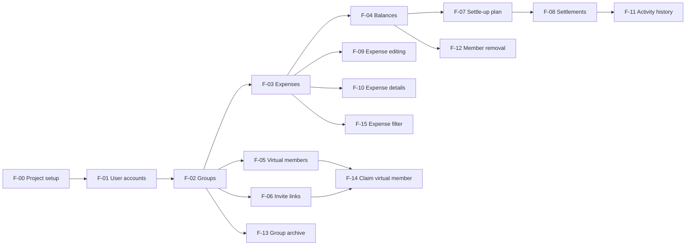
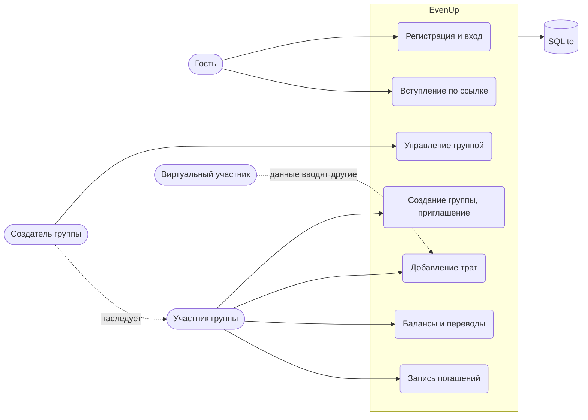
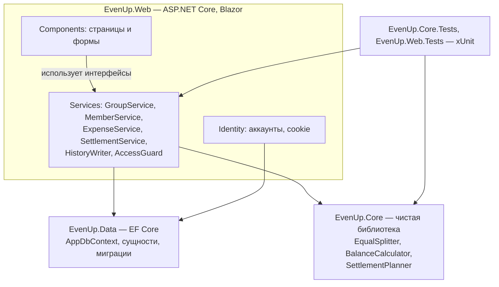
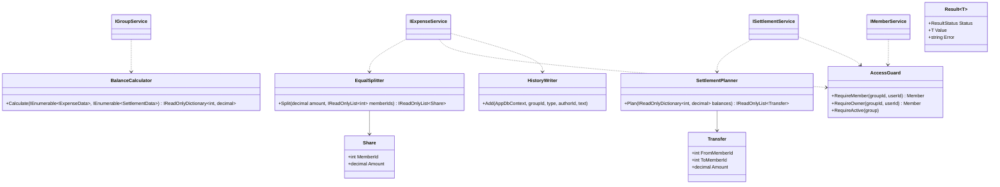
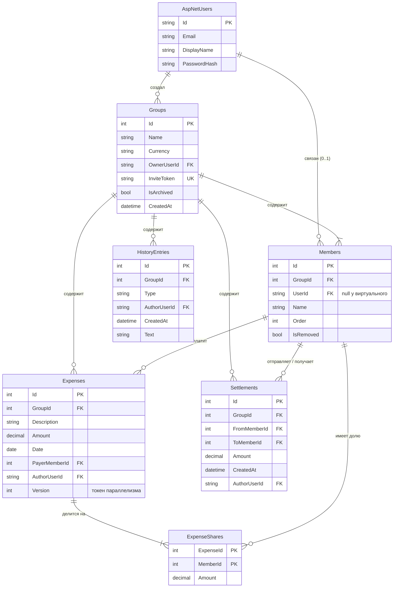
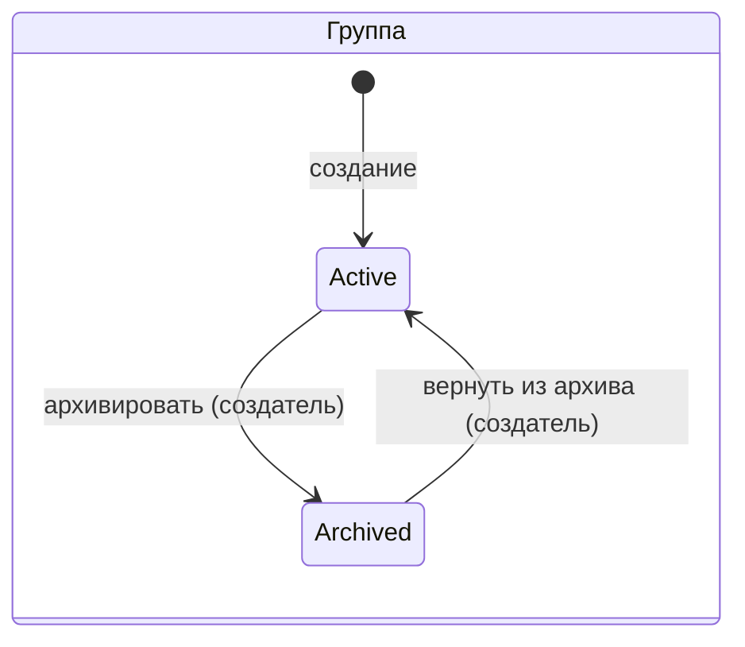
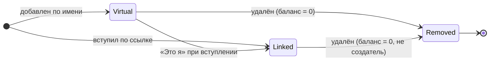
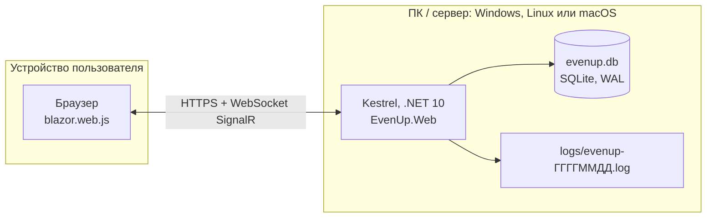

# Описание дизайна программного обеспечения

Для веб-приложения «EvenUp» — учёт совместных расходов

Версия 0.1

Подготовил(а) Чалей В. В.

БГУИР, кафедра ЭВМ

04.11.2026

## Оглавление

<!-- TOC -->
* [1. Введение](#1-introduction)
  * [1.1 Назначение документа](#11-document-purpose)
  * [1.2 Область применения](#12-subject-scope)
  * [1.3 Определения, акронимы и сокращения](#13-definitions-acronyms-and-abbreviations)
  * [1.4 Ссылки](#14-references)
  * [1.5 Обзор документа](#15-document-overview)
* [2. Обзор дизайна](#2-design-overview)
  * [2.1 Задачи стейкхолдеров](#21-stakeholder-concerns)
  * [2.2 Выбранные точки зрения](#22-selected-viewpoints)
* [3. Проектные представления](#3-design-views)
  * [3.1 Системные требования](#31-system-requirements)
  * [3.2 Приоритеты функционала](#32-feature-priorities)
  * [3.3 Представления дизайна](#33-views)
* [4. Решения](#4-decisions)
* [5. Приложения](#5-appendixes)
<!-- TOC -->

## История изменений

| Name | Date | Reason For Changes | Version |
|------|------|--------------------|---------|
| Чалей В. В. | 04.11.2026 | Первоначальная версия на основе SRS v0.1 | 0.1 |
|      |      |                    |         |

---

## 1. Введение {#1-introduction}

Документ описывает, **как** будет устроено веб-приложение «EvenUp»: из каких частей состоит система, как хранятся данные, как работают ключевые алгоритмы и какие архитектурные решения приняты. Требования к системе («что» она делает) описаны в SRS, здесь они переводятся в системные требования и проектные элементы.

### 1.1 Назначение документа {#11-document-purpose}

SDD служит руководством для разработчиков при реализации релиза 1.0 и для сопровождающего при последующих изменениях. Документ также используется Заказчиком для согласования приоритетов функционала и плана реализации. Он опирается на [SRS v0.1](srs.md), а принятые решения подробно описаны в протоколах [ADR](adr/).

### 1.2 Область применения {#12-subject-scope}

Документ охватывает «EvenUp» версии 1.0 (MVP) целиком: веб-интерфейс на Blazor, серверную бизнес-логику, базу данных SQLite и библиотеку расчётов. Система позволяет пользователям объединяться в группы, вести список совместных трат, видеть балансы и минимальный список переводов для закрытия долгов (бизнес-цели BG-1…BG-3 из SRS).

**Входит:** все требования REQ-FUNC-001…021 и нефункциональные требования раздела 3.3–3.5 SRS.

**Не входит:** функции релиза 2.0 (деление по долям, категории трат, экспорт в CSV), а также реальные платежи, уведомления и мобильные приложения.

### 1.3 Определения, акронимы и сокращения {#13-definitions-acronyms-and-abbreviations}

| Term | Definition |
|------|------------|
| ADR | Architectural Decision Record — протокол архитектурного решения |
| API | Application Programming Interface — набор определений и протоколов для создания и интеграции прикладного ПО |
| Circuit | Сеанс Blazor Interactive Server: состояние компонентов одного пользователя на сервере, связанное с браузером через SignalR |
| DI | Dependency Injection — внедрение зависимостей, встроенный механизм ASP.NET Core |
| DTO | Data Transfer Object — простой объект для передачи данных между слоями |
| EF Core | Entity Framework Core — ORM-библиотека .NET |
| ER | Entity-Relationship — модель «сущность-связь» |
| Member | Участник группы (обычный или виртуальный) |
| SDD | Software Design Document — документ, описывающий назначение, требования и характер ПО |
| Settlement | Погашение — запись о переводе денег между участниками |
| SignalR | Библиотека ASP.NET Core для двусторонней связи браузера и сервера (WebSocket) |
| SRS | Software Requirements Specification — спецификация требований к ПО |
| SYS | Префикс ID системного требования |

Остальные термины предметной области (баланс, доля, виртуальный участник и т.д.) определены в SRS, раздел 1.3.

### 1.4 Ссылки {#14-references}

| Документ | Владелец | Версия / дата | Расположение | Статус |
|----------|----------|---------------|--------------|--------|
| SRS «EvenUp» | Чалей В. В. | 0.1 / 19.10.2026 | `docs/design/srs.md` | Нормативная |
| Протоколы архитектурных решений | Чалей В. В. | 04.11.2026 | `docs/design/adr/` | Нормативная |
| Лабораторная работа №4 «Разработка и документирование системных требований» | Кафедра, дисциплина ЖЦРПО | 2026 | Выдаётся преподавателем | Нормативная |
| Шаблоны SDD и ADR | Кафедра, дисциплина ЖЦРПО | — | `Templates/sdd/`, `Templates/adr/` | Нормативная |
| Мокапы интерфейса (SysMLv2) | Чалей В. В. | 0.1 | `docs/design/sysml/`, `docs/design/images/` | Справочная |
| Документация ASP.NET Core Blazor | Microsoft | .NET 10 | https://learn.microsoft.com/aspnet/core/blazor | Справочная |
| Документация EF Core | Microsoft | 10.0 | https://learn.microsoft.com/ef/core | Справочная |

### 1.5 Обзор документа {#15-document-overview}

Раздел 2 перечисляет стейкхолдеров и выбранные точки зрения. Раздел 3 содержит системные требования с приоритетами (3.1–3.2) и проектные представления с ID вида `NNN-название` (3.3). Раздел 4 кратко перечисляет архитектурные решения, полные записи лежат в `adr/`. Диаграммы записаны в Mermaid и отображаются прямо на GitHub. При изменении документа добавляется строка в «Историю изменений», а изменённые системные требования получают суффикс версии (`SYS-FUNC-005-2`), как и в SRS.

---

## 2. Обзор дизайна {#2-design-overview}

Система — монолитное веб-приложение ASP.NET Core с интерфейсом Blazor в режиме Interactive Server. Весь код (интерфейс, логика, доступ к данным) выполняется на одном сервере, браузер получает только разметку и обновления через SignalR. Данные хранятся в одном файле SQLite. Расчётные алгоритмы вынесены в отдельную библиотеку без зависимостей от веба и базы данных, чтобы их было легко тестировать.

### 2.1 Задачи стейкхолдеров {#21-stakeholder-concerns}

| Стейкхолдер | Основные задачи | Где адресуется |
|-------------|-----------------|----------------|
| Пользователь (участник группы) | Правильные балансы, быстрый отклик, работа с телефона | 007-algorithms, 012-resources, SRS UI |
| Заказчик | Состав функций, сроки, стоимость | 3.1, 3.2, раздел 4 |
| Разработчик | Понятная структура кода, простота тестирования, минимум инфраструктуры | 002-composition, 003-logical, 005-interfaces, 010-patterns |
| Тестировщик | Трассировка требований в код и тесты | 3.1, Приложение А |
| Сопровождающий / преподаватель | Простая установка и запуск, отсутствие внешних сервисов | 011-deployment, ADR-0002 |

### 2.2 Выбранные точки зрения {#22-selected-viewpoints}

Из 15 точек зрения шаблона выбраны те, которые важны для небольшого монолитного веб-приложения. Остальные не используются по причинам, указанным в таблице.

| Точка зрения | Используется | Представление | Язык |
|--------------|:-----------:|---------------|------|
| Контекст | ✔ | 001-context | Диаграмма вариантов использования (Mermaid flowchart) |
| Композиция | ✔ | 002-composition | Диаграмма компонентов |
| Логическое представление | ✔ | 003-logical | Диаграмма классов UML |
| Физическое представление | — | Совмещено с 011-deployment: один сервер, специального оборудования нет | — |
| Структура | — | Внутренняя структура компонентов простая и покрыта 002 и 003 | — |
| Зависимости | ✔ | 002-composition (направленные зависимости проектов) | Граф зависимостей |
| Информация | ✔ | 004-information | ER-диаграмма |
| Интерфейс | ✔ | 005-interfaces | Сигнатуры методов C# |
| Взаимодействие | ✔ | 006-interactions | Диаграммы последовательности UML |
| Алгоритм | ✔ | 007-algorithms | Псевдокод |
| Динамика состояний | ✔ | 008-states | Диаграмма состояний UML |
| Параллелизм | ✔ | 009-concurrency | Описание + таблица |
| Паттерны | ✔ | 010-patterns | Таблица паттернов |
| Развёртывание | ✔ | 011-deployment | Диаграмма развёртывания |
| Ресурсы | ✔ | 012-resources | Таблица оценки ресурсов |

---

## 3. Проектные представления {#3-design-views}

### 3.1 Системные требования {#31-system-requirements}

Системные требования получены из требований SRS и описывают, что должна обеспечить каждая часть системы. Формат ID: `SYS-[AREA]-[NNN]`. Колонка «Компонент» ссылается на представление 002-composition, колонка «Приоритет» — на функцию из раздела 3.2.

#### 3.1.1 Функциональные системные требования

| ID | Требование | Из SRS | Компонент | Функция |
|----|------------|--------|-----------|---------|
| SYS-FUNC-001 | Система должна регистрировать пользователя через ASP.NET Core Identity, сохраняя email, отображаемое имя и хэш пароля, и сразу выполнять вход (cookie-аутентификация) | REQ-FUNC-001, REQ-SEC-001, REQ-SEC-007 | EvenUp.Web (Identity) | F-01 |
| SYS-FUNC-002 | Система должна выполнять вход по email и паролю, блокировать аккаунт на 5 минут после 5 неудачных попыток и перенаправлять неавторизованные запросы к защищённым страницам на `/login` | REQ-FUNC-002, REQ-SEC-006 | EvenUp.Web (Identity) | F-01 |
| SYS-FUNC-003 | `GroupService` должен создавать группу с названием и валютой, добавляя создателя первым участником (`Order = 0`) в одной транзакции | REQ-FUNC-003 | GroupService | F-02 |
| SYS-FUNC-004 | `GroupService` должен возвращать список групп пользователя с его балансом в каждой, разделяя активные и архивные группы | REQ-FUNC-004 | GroupService, BalanceCalculator | F-02 |
| SYS-FUNC-005 | `ExpenseService` должен сохранять трату вместе с долями в одной транзакции; доли рассчитываются `EqualSplitter` | REQ-FUNC-011, REQ-FUNC-012, REQ-REL-001 | ExpenseService, EqualSplitter | F-03 |
| SYS-FUNC-006 | `EqualSplitter` должен делить сумму на N долей с округлением вниз до 0,01 и раздавать остаток по 0,01 участникам с наименьшим `Order` | REQ-FUNC-012 | EvenUp.Core | F-03 |
| SYS-FUNC-007 | `BalanceCalculator` должен вычислять балансы участников по тратам, долям и погашениям группы при каждом запросе (баланс не хранится в БД) | REQ-FUNC-014 | EvenUp.Core | F-04 |
| SYS-FUNC-008 | `MemberService` должен добавлять виртуального участника с `UserId = null`, проверяя уникальность имени в группе и лимит 30 участников | REQ-FUNC-008, REQ-FUNC-021 | MemberService | F-05 |
| SYS-FUNC-009 | `GroupService` должен хранить токен приглашения (128 бит, `RandomNumberGenerator`, base64url) и перевыпускать его по запросу создателя | REQ-FUNC-006, REQ-SEC-004 | GroupService | F-06 |
| SYS-FUNC-010 | `MemberService` должен добавлять пользователя в группу по действующему токену; при повторном вступлении возвращать существующего участника, для архивной или заполненной группы — ошибку | REQ-FUNC-007, REQ-FUNC-021 | MemberService | F-06 |
| SYS-FUNC-011 | `SettlementPlanner` должен строить список переводов жадным алгоритмом не более чем из N − 1 переводов | REQ-FUNC-015 | EvenUp.Core | F-07 |
| SYS-FUNC-012 | `SettlementService` должен записывать и удалять погашения с проверкой прав (автор или создатель группы) и запретом совпадения отправителя и получателя | REQ-FUNC-016, REQ-FUNC-017 | SettlementService | F-08 |
| SYS-FUNC-013 | `ExpenseService` должен разрешать изменение и удаление траты только её автору и создателю группы; изменение пересчитывает доли | REQ-FUNC-013, REQ-SEC-002 | ExpenseService, AccessGuard | F-09 |
| SYS-FUNC-014 | `ExpenseService` должен возвращать детали траты с долями каждого участника | REQ-FUNC-019 | ExpenseService | F-10 |
| SYS-FUNC-015 | Каждая изменяющая операция сервисов должна добавлять ровно одну запись `HistoryEntry` в той же транзакции; для записей истории не предусмотрено методов изменения и удаления | REQ-FUNC-018 | Все сервисы, HistoryWriter | F-11 |
| SYS-FUNC-016 | `MemberService` должен разрешать создателю мягкое удаление участника (`IsRemoved = true`) только при нулевом балансе; создателя удалить нельзя | REQ-FUNC-010 | MemberService | F-12 |
| SYS-FUNC-017 | `GroupService` должен разрешать создателю переименовать группу и менять признак `IsArchived`; все изменяющие операции над архивной группой отклоняются | REQ-FUNC-005 | GroupService, AccessGuard | F-13 |
| SYS-FUNC-018 | `MemberService` при вступлении должен позволять связать виртуального участника с аккаунтом (заполнить `UserId`) в одной транзакции, если он ещё не связан | REQ-FUNC-009, REQ-REL-001 | MemberService | F-14 |
| SYS-FUNC-019 | `ExpenseService` должен фильтровать траты по участнику (плательщик или участник деления) запросом к БД | REQ-FUNC-020 | ExpenseService | F-15 |

#### 3.1.2 Нефункциональные системные требования

| ID | Требование | Из SRS | Компонент |
|----|------------|--------|-----------|
| SYS-NFR-001 | Каждая операция сервиса должна создавать короткоживущий `DbContext` через `IDbContextFactory` и освобождать его по завершении | REQ-PERF-001, REQ-REL-003 | Все сервисы |
| SYS-NFR-002 | Расчёт балансов и переводов для группы из 30 участников и 1000 трат должен выполняться в памяти за один запрос к БД за не более чем 200 мс | REQ-PERF-002 | BalanceCalculator, SettlementPlanner |
| SYS-NFR-003 | Перед каждой операцией с группой `AccessGuard` должен проверять, что текущий пользователь — её участник; иначе сервис возвращает результат `NotFound` | REQ-SEC-002 | AccessGuard |
| SYS-NFR-004 | Сущность `Expense` должна иметь целочисленный токен параллелизма `Version`; при конфликте сервис возвращает `Conflict` и актуальную версию траты | REQ-REL-003 | ExpenseService, EvenUp.Data |
| SYS-NFR-005 | Все денежные поля в коде должны иметь тип `decimal`, в SQLite храниться как `TEXT` через конвертер EF Core (без потери точности) | REQ-REL-002 | EvenUp.Core, EvenUp.Data |
| SYS-NFR-006 | Приложение должно применять миграции EF Core при старте (`Database.Migrate()`), если файла БД нет — создавать его | REQ-INST-002, REQ-CM-004 | EvenUp.Web (Program.cs) |
| SYS-NFR-007 | Логирование должно выполняться через `ILogger` с выводом в консоль и в файл с ротацией по дням и хранением 7 файлов; пароли, токены и email не логируются | REQ-OBS-001…003 | EvenUp.Web |
| SYS-NFR-008 | Сборка `EvenUp.Core` не должна ссылаться на ASP.NET Core и EF Core; это проверяется архитектурным тестом | REQ-REUSE-001, REQ-MAINT-001 | EvenUp.Core, EvenUp.Core.Tests |
| SYS-NFR-009 | Компоненты Razor не должны получать `DbContext` через DI, только интерфейсы сервисов | REQ-MAINT-001 | EvenUp.Web |
| SYS-NFR-010 | Интерфейс должен показывать компонент переподключения Blazor с текстом «Переподключение…» и временем ожидания 60 секунд | REQ-REL-004 | EvenUp.Web (App.razor) |
| SYS-NFR-011 | Вёрстка должна строиться на CSS Grid/Flexbox с одной колонкой при ширине до 600 px | REQ-INT-001, REQ-PORT-002 | EvenUp.Web |

### 3.2 Приоритеты функционала {#32-feature-priorities}

Функции пронумерованы `F-NN` и названы на английском, как принято в задачах команды. Приоритет ранжируется от **10** (наивысший, без этого продукт не имеет смысла) до **50** (минимальный, можно отложить без вреда для основного сценария):

- **10** — критично: основной сценарий «записать траты → увидеть, кто сколько должен»;
- **20** — важно: без этого продуктом неудобно пользоваться в реальной компании;
- **30** — желательно: прозрачность и исправление ошибок;
- **40** — полезно: управление группой и удобства;
- **50** — можно отложить.

| ID | Feature | Описание | Требования SRS | Зависит от | Priority |
|----|---------|----------|----------------|------------|:--------:|
| F-00 | Project setup | Решение из 5 проектов, Identity, SQLite, миграции, логирование, CI-сборка | REQ-POC-001, REQ-INST-*, REQ-BUILD-*, REQ-OBS-* | — | 10 |
| F-01 | User accounts | Регистрация, вход, выход, блокировка после неудачных попыток | REQ-FUNC-001, 002 | F-00 | 10 |
| F-02 | Groups | Создание группы и список «Мои группы» с балансами | REQ-FUNC-003, 004 | F-01 | 10 |
| F-03 | Expenses | Добавление траты с делением поровну | REQ-FUNC-011, 012 | F-02 | 10 |
| F-04 | Balances | Расчёт и отображение балансов | REQ-FUNC-014 | F-03 | 10 |
| F-05 | Virtual members | Участники без аккаунта | REQ-FUNC-008, 021 | F-02 | 20 |
| F-06 | Invite links | Ссылка-приглашение и вступление по ней | REQ-FUNC-006, 007, 021 | F-02 | 20 |
| F-07 | Settle-up plan | Минимальный список переводов | REQ-FUNC-015 | F-04 | 20 |
| F-08 | Settlements | Запись и удаление погашений | REQ-FUNC-016, 017 | F-07 | 20 |
| F-09 | Expense editing | Редактирование и удаление трат с проверкой прав, оптимистическая блокировка | REQ-FUNC-013, REQ-REL-003 | F-03 | 20 |
| F-10 | Expense details | Детали траты с долями | REQ-FUNC-019 | F-03 | 30 |
| F-11 | Activity history | Лента операций группы | REQ-FUNC-018 | F-03, F-08 | 30 |
| F-12 | Member removal | Удаление участника с нулевым балансом | REQ-FUNC-010 | F-04 | 30 |
| F-13 | Group archive | Переименование и архивирование группы | REQ-FUNC-005 | F-02 | 40 |
| F-14 | Claim virtual member | Привязка виртуального участника к аккаунту при вступлении | REQ-FUNC-009 | F-05, F-06 | 40 |
| F-15 | Expense filter | Фильтр трат по участнику | REQ-FUNC-020 | F-03 | 50 |

Зависимости функций:



### 3.3 Представления дизайна {#33-views}

#### 001-context

- **ID**: 001-context
- **Title**: Границы системы и акторы
- **Viewpoint**: Контекст
- **Representation**:



  Система не взаимодействует с внешними сервисами (ограничение C-4 SRS). Единственная внешняя зависимость во время работы — файл базы данных.
- **More Information**: SRS, разделы 2.1 и 2.4; Приложение В SRS (UC-01…UC-07).

#### 002-composition

- **ID**: 002-composition
- **Title**: Проекты решения и зависимости между ними
- **Viewpoint**: Композиция, Зависимости
- **Representation**:



  | Проект | Тип | Ответственность | Зависимости |
  |--------|-----|-----------------|-------------|
  | EvenUp.Core | Class Library | Алгоритмы деления, балансов и переводов, доменные значения (`Money`, `Share`) | Нет (только BCL) |
  | EvenUp.Data | Class Library | `AppDbContext`, сущности, конфигурация, миграции | EF Core, EF Core SQLite, Identity EF Core |
  | EvenUp.Web | Blazor Web App | UI, сервисы бизнес-логики, Identity, DI, логирование | EvenUp.Core, EvenUp.Data |
  | EvenUp.Core.Tests | xUnit | Модульные тесты алгоритмов, тест производительности, архитектурный тест | EvenUp.Core |
  | EvenUp.Web.Tests | xUnit | Тесты сервисов на SQLite in-memory (права, транзакции, история) | EvenUp.Web |

  Направление зависимостей одно: UI → сервисы → данные и ядро. Ядро ни от чего не зависит (SYS-NFR-008).
- **More Information**: ADR-0001, ADR-0002; SRS REQ-MAINT-001, REQ-REUSE-001.

#### 003-logical

- **ID**: 003-logical
- **Title**: Основные классы
- **Viewpoint**: Логическое представление
- **Representation**:



  Сервисы возвращают `Result<T>` со статусом `Ok`, `NotFound`, `Forbidden`, `Invalid` или `Conflict`, а не бросают исключения на ожидаемые ошибки. Страница показывает сообщение по статусу (REQ-INT-003).
- **More Information**: 005-interfaces, 007-algorithms.

#### 004-information

- **ID**: 004-information
- **Title**: Схема базы данных
- **Viewpoint**: Информация
- **Representation**:



  Ограничения и индексы:

  | Таблица | Ограничение / индекс | Зачем |
  |---------|----------------------|-------|
  | Groups | `UNIQUE(InviteToken)` | Поиск группы по ссылке |
  | Members | `UNIQUE(GroupId, Name)` | Уникальное имя в группе (REQ-FUNC-008) |
  | Members | `UNIQUE(GroupId, UserId) WHERE UserId IS NOT NULL` | Пользователь входит в группу один раз (REQ-FUNC-007) |
  | Expenses | `INDEX(GroupId, Date DESC)` | Список трат группы |
  | ExpenseShares | `PK(ExpenseId, MemberId)`, каскадное удаление с тратой | Доли удаляются вместе с тратой |
  | Settlements | `CHECK(FromMemberId <> ToMemberId)` | REQ-FUNC-016 |
  | HistoryEntries | `INDEX(GroupId, CreatedAt DESC)` | Лента истории |

  Удаление участников мягкое (`IsRemoved`), чтобы траты в истории сохраняли ссылки на участника (REQ-FUNC-010). Балансы не хранятся, а вычисляются (ADR-0005). Денежные поля хранятся как `TEXT` через конвертер `decimal ↔ string` (SYS-NFR-005).
- **More Information**: SRS, Приложение А; ADR-0004, ADR-0005.

#### 005-interfaces

- **ID**: 005-interfaces
- **Title**: Интерфейсы сервисов
- **Viewpoint**: Интерфейс
- **Representation**:

```csharp
public interface IGroupService
{
    Task<Result<int>> CreateAsync(string userId, string name, string currency);
    Task<IReadOnlyList<GroupSummaryDto>> GetMyGroupsAsync(string userId);   // с балансом пользователя
    Task<Result<GroupDto>> GetAsync(string userId, int groupId);
    Task<Result> RenameAsync(string userId, int groupId, string newName);   // только создатель
    Task<Result> SetArchivedAsync(string userId, int groupId, bool archived);
    Task<Result<string>> RegenerateInviteAsync(string userId, int groupId);
    Task<Result<BalancesDto>> GetBalancesAsync(string userId, int groupId); // балансы + переводы
}

public interface IMemberService
{
    Task<Result<IReadOnlyList<MemberDto>>> GetAsync(string userId, int groupId);
    Task<Result<int>> AddVirtualAsync(string userId, int groupId, string name);
    Task<Result<JoinInfoDto>> GetJoinInfoAsync(string token);               // группа и свободные виртуальные
    Task<Result<int>> JoinAsync(string userId, string token, int? claimVirtualMemberId);
    Task<Result> RemoveAsync(string userId, int groupId, int memberId);     // только при балансе 0
}

public interface IExpenseService
{
    Task<Result<IReadOnlyList<ExpenseListItemDto>>> GetListAsync(string userId, int groupId, int? filterMemberId);
    Task<Result<ExpenseDetailsDto>> GetDetailsAsync(string userId, int expenseId);
    Task<Result<int>> AddAsync(string userId, ExpenseInput input);
    Task<Result> UpdateAsync(string userId, int expenseId, ExpenseInput input, int expectedVersion);
    Task<Result> DeleteAsync(string userId, int expenseId);
}

public interface ISettlementService
{
    Task<Result<int>> AddAsync(string userId, int groupId, int fromMemberId, int toMemberId, decimal amount);
    Task<Result> DeleteAsync(string userId, int settlementId);
}

public interface IHistoryService
{
    Task<Result<IReadOnlyList<HistoryEntryDto>>> GetAsync(string userId, int groupId, int skip, int take);
}
```

  Контракты, общие для всех методов:
  - `userId` берётся из `AuthenticationState` на сервере, а не из параметров страницы;
  - если пользователь не участник группы, возвращается `NotFound` (REQ-SEC-002);
  - изменяющие методы для архивной группы возвращают `Invalid` с текстом «Группа в архиве»;
  - суммы проверяются на диапазон 0,01…100 000,00 до обращения к БД.

  Страницы и маршруты соответствуют мокапам SRS: `/login`, `/register`, `/groups`, `/groups/{id}/expenses`, `/groups/{id}/expenses/new`, `/groups/{id}/expenses/{expenseId}`, `/groups/{id}/balances`, `/groups/{id}/members`, `/groups/{id}/history`, `/join/{token}`.
- **More Information**: SRS 3.1.1 (UI-01…UI-08), 003-logical.

#### 006-interactions

- **ID**: 006-interactions
- **Title**: Добавление траты и вступление в группу
- **Viewpoint**: Взаимодействие
- **Representation**:

  Добавление траты (основной сценарий и отказ по правам):

```mermaid
sequenceDiagram
    actor U as Участник
    participant P as ExpenseForm.razor
    participant S as ExpenseService
    participant G as AccessGuard
    participant C as EqualSplitter
    participant D as AppDbContext (SQLite)
    U->>P: Заполняет форму, «Сохранить»
    P->>S: AddAsync(userId, input)
    S->>D: CreateDbContext()
    S->>G: RequireMember(groupId, userId)
    alt не участник
        G-->>S: NotFound
        S-->>P: Result.NotFound
        P-->>U: «Группа не найдена»
    else участник, группа активна
        S->>C: Split(amount, memberIds)
        C-->>S: доли (сумма = amount)
        S->>D: BEGIN; INSERT Expense, ExpenseShares, HistoryEntry; COMMIT
        S-->>P: Result.Ok(expenseId)
        P-->>U: Переход к списку трат, балансы обновлены
    end
```

  Вступление по ссылке с привязкой виртуального участника:

```mermaid
sequenceDiagram
    actor U as Пользователь
    participant J as Join.razor
    participant M as MemberService
    participant D as AppDbContext
    U->>J: Открывает /join/{token}
    alt гость
        J-->>U: Редирект на /login?returnUrl=/join/{token}
        U->>J: Вход, возврат на /join/{token}
    end
    J->>M: GetJoinInfoAsync(token)
    M-->>J: Группа, список несвязанных виртуальных участников
    U->>J: Выбирает «Я — Вика», «Вступить»
    J->>M: JoinAsync(userId, token, claimId)
    M->>D: BEGIN; UPDATE Members SET UserId; INSERT HistoryEntry; COMMIT
    M-->>J: Result.Ok(groupId)
    J-->>U: Переход в группу
```
- **More Information**: SYS-FUNC-005, SYS-FUNC-010, SYS-FUNC-018; SRS UI-04, UI-08.

#### 007-algorithms

- **ID**: 007-algorithms
- **Title**: Деление траты, балансы и список переводов
- **Viewpoint**: Алгоритм
- **Representation**:

  **EqualSplitter.Split** (REQ-FUNC-012). Участники упорядочены по `Order`.

```text
cents  = amount * 100                      // целое число копеек
base   = cents div n
rest   = cents mod n                       // 0 <= rest < n
для i от 0 до n-1:
    share[i] = (base + (i < rest ? 1 : 0)) / 100
// сумма долей = (base*n + rest)/100 = amount
```

  Пример: 10,00 на 3 → 1000 коп., base = 333, rest = 1 → 3,34 / 3,33 / 3,33. Сложность O(n).

  **BalanceCalculator.Calculate** (REQ-FUNC-014):

```text
balance[m] = 0 для всех участников
для каждой траты e:    balance[e.payer] += e.amount
    для каждой доли s: balance[s.member] -= s.amount
для каждого погашения p:
    balance[p.from] += p.amount
    balance[p.to]   -= p.amount
// инвариант: сумма balance = 0
```

  Сложность O(E + S), где E — число долей, S — число погашений. Для 1000 трат на 30 участников это около 30 000 операций сложения, что укладывается в 200 мс с большим запасом (SYS-NFR-002).

  **SettlementPlanner.Plan** (REQ-FUNC-015), жадный алгоритм:

```text
debtors   = участники с balance < 0, |balance| по убыванию
creditors = участники с balance > 0, по убыванию
пока debtors и creditors не пусты:
    d = наибольший должник, c = наибольший кредитор
    x = min(|balance[d]|, balance[c])
    добавить перевод d → c на сумму x
    balance[d] += x; balance[c] -= x
    убрать из списков тех, чей баланс стал 0
```

  На каждом шаге хотя бы один участник обнуляется, поэтому переводов не больше N − 1. Сложность O(N²) при N ≤ 30. Жадный алгоритм не всегда даёт абсолютный минимум (это NP-трудная задача), но гарантирует требуемую границу N − 1. Обоснование — ADR-0006.

  Для примера из Приложения Б SRS: балансы Аня +50, Борис −10, Вика −40 → Вика → Аня 40,00; Борис → Аня 10,00.
- **More Information**: ADR-0006; SRS REQ-FUNC-012, 014, 015, REQ-POC-002.

#### 008-states

- **ID**: 008-states
- **Title**: Состояния группы и участника
- **Viewpoint**: Динамика состояний
- **Representation**:





  | Состояние группы | Разрешено |
  |------------------|-----------|
  | Active | Все операции согласно правам |
  | Archived | Только чтение; изменить можно только признак архива |

  Состояние участника задаётся полями: `Virtual` — `UserId = null`, `Linked` — `UserId` заполнен, `Removed` — `IsRemoved = true`.
- **More Information**: SRS REQ-FUNC-005, 009, 010; диаграмма навигации SRS (ui-00-navigation).

#### 009-concurrency

- **ID**: 009-concurrency
- **Title**: Параллельная работа пользователей
- **Viewpoint**: Параллелизм
- **Representation**:

  В Blazor Interactive Server у каждой вкладки браузера свой circuit на сервере, события одного circuit обрабатываются последовательно, разные circuit работают параллельно.

  | Ситуация | Решение |
  |----------|---------|
  | Долгоживущий circuit и `DbContext` (контекст не потокобезопасен и разрастается) | `IDbContextFactory<AppDbContext>`: новый контекст на каждую операцию сервиса (SYS-NFR-001) |
  | Два пользователя редактируют одну трату | Поле `Version` как токен параллелизма; при `DbUpdateConcurrencyException` — `Result.Conflict` и перезагрузка формы с актуальными данными (REQ-REL-003) |
  | Два пользователя одновременно вступают в группу на 30-м месте | Проверка лимита и вставка в одной транзакции; SQLite выполняет записи последовательно, второй получает ошибку лимита |
  | Одновременные записи в SQLite | Режим журнала WAL: чтение не блокируется записью; запись сериализуется самой СУБД |
  | Другой участник добавил трату, пока я смотрю балансы | В релизе 1.0 данные обновляются при переходе между вкладками группы; живое обновление не требуется SRS |
- **More Information**: ADR-0001, ADR-0002.

#### 010-patterns

- **ID**: 010-patterns
- **Title**: Применённые паттерны
- **Viewpoint**: Паттерны
- **Representation**:

  | Паттерн | Где | Зачем |
  |---------|-----|-------|
  | Слоистая архитектура | UI → Services → Data/Core | REQ-MAINT-001 |
  | Service Layer | `*Service` в EvenUp.Web | Вся бизнес-логика и проверки прав в одном месте |
  | Unit of Work | `AppDbContext` + `SaveChanges` в одной транзакции | REQ-REL-001 |
  | Dependency Injection | Регистрация сервисов в `Program.cs` | Подмена реализаций в тестах |
  | Result Object | `Result<T>` | Ожидаемые ошибки без исключений |
  | Strategy (на будущее) | `EqualSplitter` за интерфейсом `ISplitter` | Деление по долям в релизе 2.0 добавляется новой реализацией |
  | Optimistic Concurrency | `Expense.Version` | REQ-REL-003 |
  | Soft Delete | `Member.IsRemoved` | REQ-FUNC-010 |

  Отдельный слой репозиториев не вводится: `DbContext` уже реализует Repository и Unit of Work, а лишняя обёртка только усложнит код.
- **More Information**: 002-composition, 003-logical.

#### 011-deployment

- **ID**: 011-deployment
- **Title**: Развёртывание
- **Viewpoint**: Развёртывание (совмещено с физическим представлением)
- **Representation**:



  - Запуск: `dotnet run --project src/EvenUp.Web` (REQ-INST-001), миграции применяются при старте.
  - Конфигурация: строка подключения и уровень логов в `appsettings.json`, локальные переопределения — в `appsettings.Development.json` (не коммитится).
  - Окружения: Development (ПК разработчика) и Demo (тот же ПК, доступ с телефона по локальной сети, REQ-POC-001).
  - CI: GitHub Actions на каждый pull request выполняет `dotnet build` и `dotnet test` (REQ-BUILD-002, 003).
- **More Information**: ADR-0002; SRS 3.5.1–3.5.3.

#### 012-resources

- **ID**: 012-resources
- **Title**: Оценка ресурсов
- **Viewpoint**: Ресурсы
- **Representation**:

  | Ресурс | Оценка | Основание |
  |--------|--------|-----------|
  | Память на один circuit | ~0,5 МБ | Небольшие страницы, данные только текущей группы |
  | Память сервера при 20 пользователях | < 300 МБ | 20 circuit + базовое потребление ASP.NET Core |
  | Размер одной траты в БД | ~0,5 КБ с долями | 1 строка Expenses + до 30 строк ExpenseShares |
  | БД на 100 групп × 1000 трат | ~50 МБ | Укладывается в REQ-PERF-003 (100 МБ) |
  | Соединения SignalR | 1 WebSocket на вкладку | Ограничение A-3 SRS: до 20 пользователей |
  | Время расчёта балансов | < 10 мс | O(E + S), см. 007-algorithms |
- **More Information**: SRS REQ-PERF-001…003, A-3.

---

## 4. Решения {#4-decisions}

Каждое решение оформлено отдельным файлом по шаблону ADR в каталоге [`adr/`](adr/).

| ID | Title | Context | Options | Outcome | More Information |
|----|-------|---------|---------|---------|------------------|
| 0001-blazor-server | Интерфейс на Blazor Interactive Server | Нужен интерактивный веб-UI на C# одним разработчиком | Blazor Server; Blazor WebAssembly + Web API; ASP.NET Core MVC + JS | «Blazor Server», потому что не нужен отдельный API, весь код на C# и данные не уходят в браузер | [ADR-0001](adr/0001-blazor-server.md) |
| 0002-sqlite | Хранение данных в SQLite через EF Core | Нужна БД без установки и платы | SQLite; PostgreSQL; SQL Server LocalDB | «SQLite», потому что это один файл, работает на всех ОС и хватает для 20 пользователей | [ADR-0002](adr/0002-sqlite.md) |
| 0003-identity | Аутентификация через ASP.NET Core Identity | Нужны регистрация, хэши паролей, блокировка | Identity; своя реализация; внешний OAuth | «Identity», потому что всё требуемое есть из коробки | [ADR-0003](adr/0003-identity.md) |
| 0004-member-entity | Единая сущность Member для обычных и виртуальных участников | Виртуальные участники должны участвовать в тратах наравне с пользователями | Member с nullable UserId; отдельные таблицы; псевдо-аккаунты | «Member с nullable UserId», потому что привязка — это заполнение одного поля | [ADR-0004](adr/0004-member-entity.md) |
| 0005-computed-balances | Балансы вычисляются, а не хранятся | Балансы меняются при любой операции | Вычислять при запросе; хранить и обновлять; кэш | «Вычислять», потому что нет риска рассинхронизации, а объём данных мал | [ADR-0005](adr/0005-computed-balances.md) |
| 0006-greedy-settlement | Жадный алгоритм списка переводов | Нужно ≤ N − 1 переводов | Жадный; точный перебор; переводы по каждой трате | «Жадный», потому что прост, быстр и даёт гарантию N − 1 | [ADR-0006](adr/0006-greedy-settlement.md) |

---

## 5. Приложения {#5-appendixes}

### Приложение А. Трассировка требований SRS

| Требование SRS | Системные требования | Представления | ADR |
|----------------|---------------------|---------------|-----|
| REQ-FUNC-001, 002 | SYS-FUNC-001, 002 | 002, 011 | 0003 |
| REQ-FUNC-003, 004 | SYS-FUNC-003, 004 | 004, 005 | 0005 |
| REQ-FUNC-005 | SYS-FUNC-017 | 008 | — |
| REQ-FUNC-006, 007 | SYS-FUNC-009, 010 | 005, 006 | — |
| REQ-FUNC-008, 009 | SYS-FUNC-008, 018 | 004, 006, 008 | 0004 |
| REQ-FUNC-010 | SYS-FUNC-016 | 004, 008 | 0004 |
| REQ-FUNC-011, 012 | SYS-FUNC-005, 006 | 006, 007 | — |
| REQ-FUNC-013 | SYS-FUNC-013, SYS-NFR-004 | 009 | — |
| REQ-FUNC-014 | SYS-FUNC-007 | 007 | 0005 |
| REQ-FUNC-015 | SYS-FUNC-011 | 007 | 0006 |
| REQ-FUNC-016, 017 | SYS-FUNC-012 | 005 | — |
| REQ-FUNC-018 | SYS-FUNC-015 | 004 | — |
| REQ-FUNC-019, 020 | SYS-FUNC-014, 019 | 005 | — |
| REQ-FUNC-021 | SYS-FUNC-008, 010 | 009 | — |
| REQ-PERF-001…003 | SYS-NFR-001, 002 | 012 | 0002, 0005 |
| REQ-SEC-001…007 | SYS-FUNC-001, 002, 009, SYS-NFR-003, 007 | 005 | 0003 |
| REQ-REL-001…004 | SYS-FUNC-005, 018, SYS-NFR-004, 005, 010 | 009 | 0001 |
| REQ-MAINT-001, REQ-REUSE-001 | SYS-NFR-008, 009 | 002, 010 | — |
| REQ-INST-*, REQ-BUILD-* | SYS-NFR-006 | 011 | 0002 |

### Приложение Б. Структура репозитория с кодом

```text
src/
  EvenUp.Core/          EqualSplitter.cs, BalanceCalculator.cs, SettlementPlanner.cs
  EvenUp.Data/          AppDbContext.cs, Entities/, Migrations/
  EvenUp.Web/           Program.cs, Components/Pages/, Services/, appsettings.json
tests/
  EvenUp.Core.Tests/    SplitTests.cs, BalanceTests.cs, SettlementTests.cs, PerformanceTests.cs
  EvenUp.Web.Tests/     ExpenseServiceTests.cs, MemberServiceTests.cs, ...
EvenUp.sln
README.md
```
