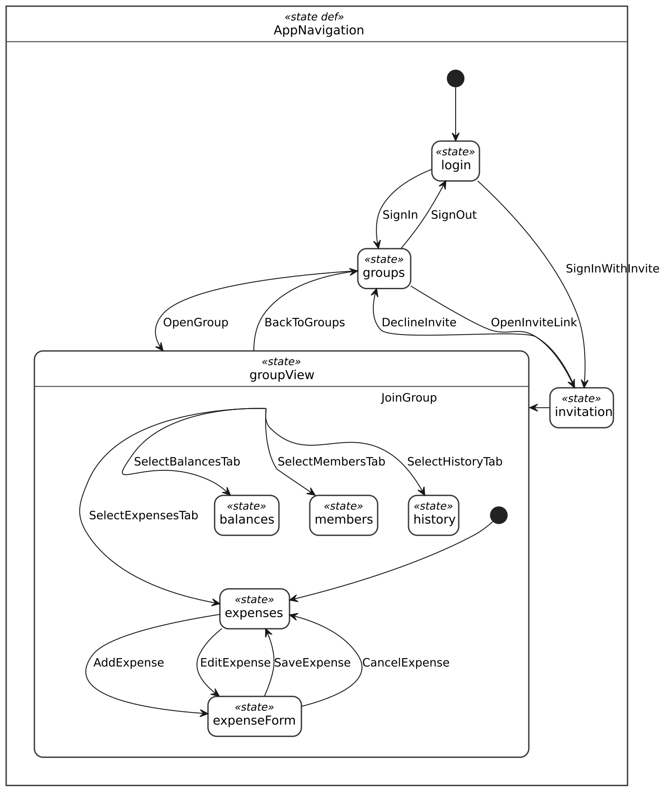
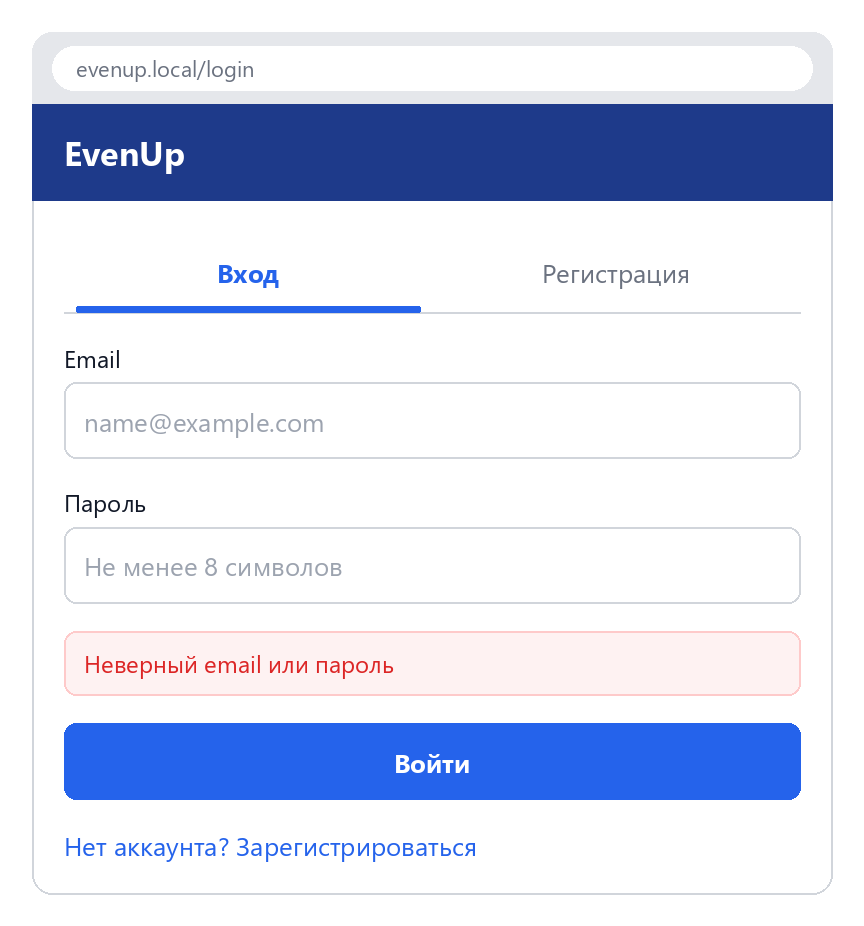
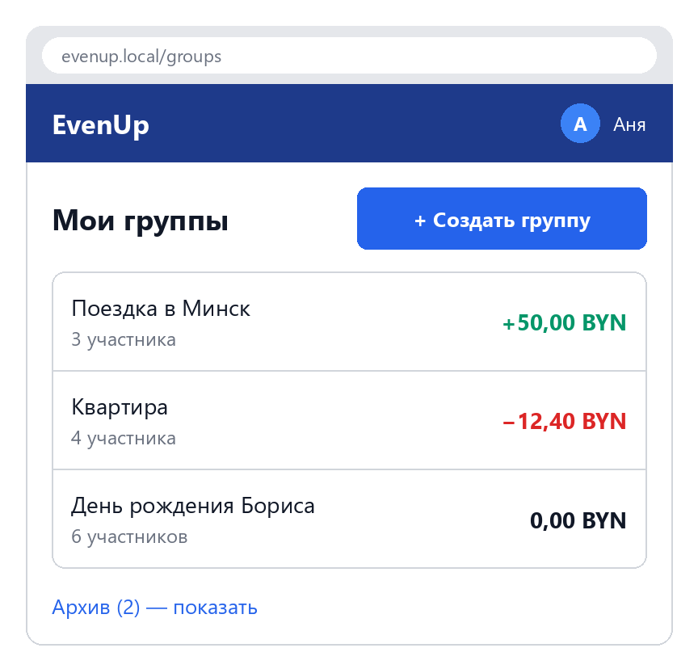
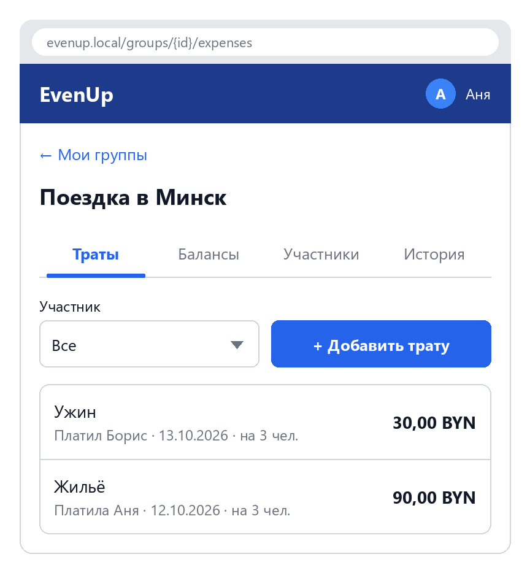
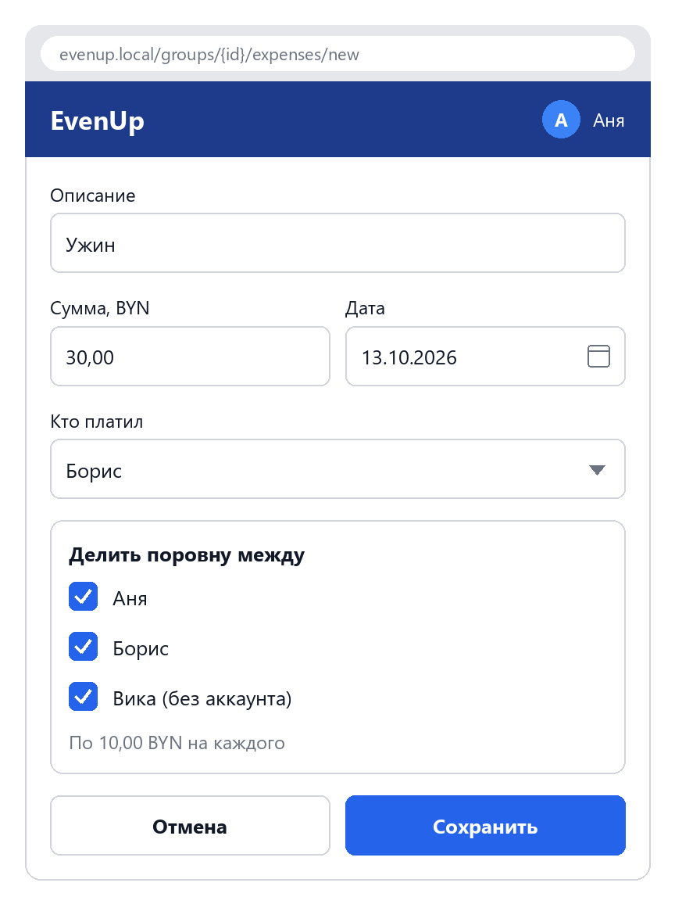
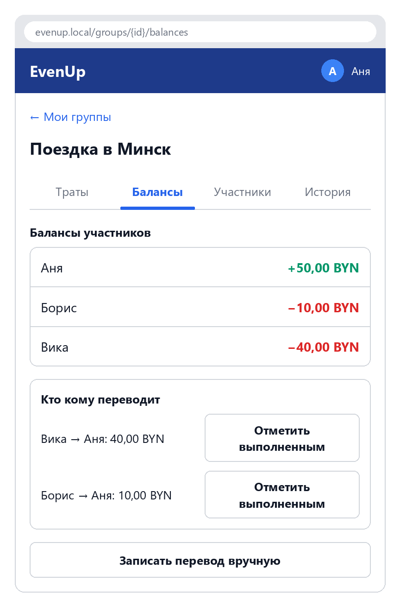
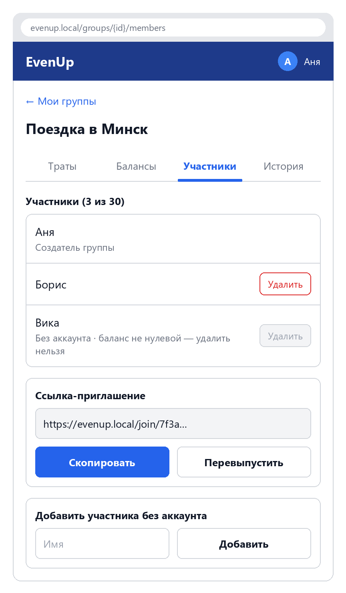
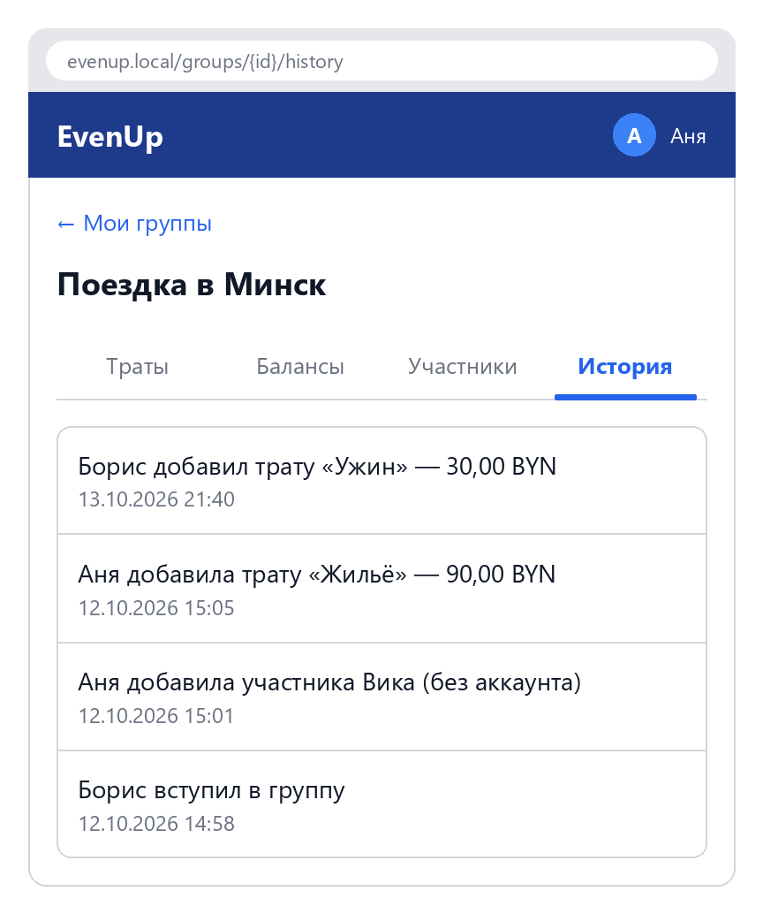
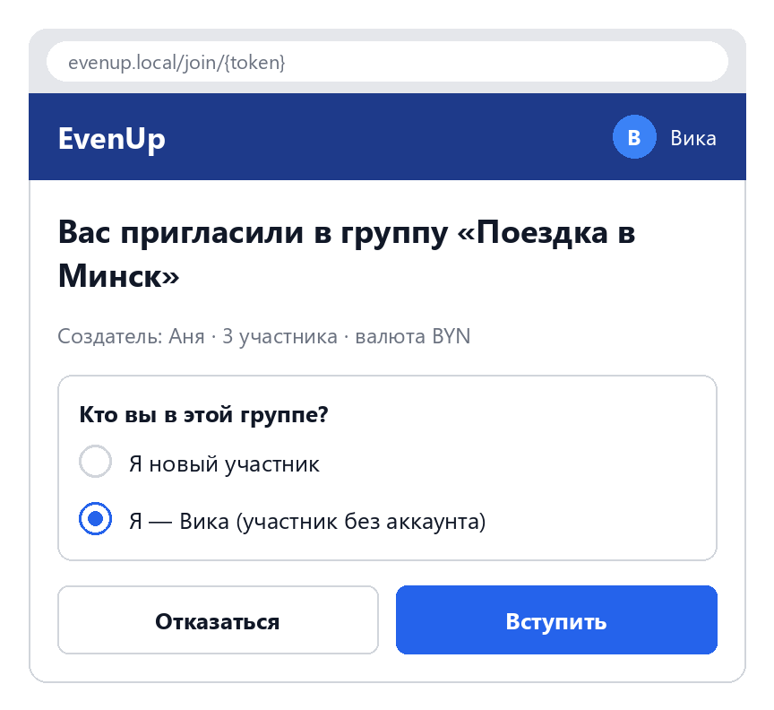

# Спецификация требований к ПО

Для веб-приложения «EvenUp» — учёт совместных расходов

Версия 0.1

Подготовил(а) Чалей В. В.

БГУИР, кафедра ЭВМ

19.10.2026

## Оглавление

<!-- TOC -->
* [1. Введение](#1-introduction)
  * [1.1 Назначение документа](#11-document-purpose)
  * [1.2 Область применения продукта](#12-product-scope)
  * [1.3 Определения, акронимы и сокращения](#13-definitions-acronyms-and-abbreviations)
  * [1.4 Ссылки](#14-references)
  * [1.5 Обзор документа](#15-document-overview)
* [2. Обзор продукта](#2-product-overview)
  * [2.1 Перспектива продукта](#21-product-perspective)
  * [2.2 Функции продукта](#22-product-functions)
  * [2.3 Ограничения продукта](#23-product-constraints)
  * [2.4 Характеристики пользователей](#24-user-characteristics)
  * [2.5 Допущения и зависимости](#25-assumptions-and-dependencies)
  * [2.6 Распределение требований](#26-apportioning-of-requirements)
* [3. Требования](#3-requirements)
  * [3.1 Внешние интерфейсы](#31-external-interfaces)
    * [3.1.1 Пользовательские интерфейсы](#311-user-interfaces)
    * [3.1.2 Аппаратные интерфейсы](#312-hardware-interfaces)
    * [3.1.3 Программные интерфейсы](#313-software-interfaces)
  * [3.2 Функциональные требования](#32-functional)
  * [3.3 Качество обслуживания](#33-quality-of-service)
    * [3.3.1 Производительность](#331-performance)
    * [3.3.2 Безопасность](#332-security)
    * [3.3.3 Надёжность](#333-reliability)
    * [3.3.4 Доступность](#334-availability)
    * [3.3.5 Наблюдаемость](#335-observability)
  * [3.4 Соответствие стандартам](#34-compliance)
  * [3.5 Проектирование и реализация](#35-design-and-implementation)
    * [3.5.1 Установка](#351-installation)
    * [3.5.2 Сборка и поставка](#352-build-and-delivery)
    * [3.5.3 Распределение](#353-distribution)
    * [3.5.4 Сопровождаемость](#354-maintainability)
    * [3.5.5 Повторное использование](#355-reusability)
    * [3.5.6 Переносимость](#356-portability)
    * [3.5.7 Стоимость](#357-cost)
    * [3.5.8 Сроки](#358-deadline)
    * [3.5.9 Доказательство концепции](#359-proof-of-concept)
    * [3.5.10 Управление изменениями](#3510-change-management)
  * [3.6 ИИ/МО](#36-aiml)
* [4. Верификация](#4-verification)
* [5. Приложения](#5-appendixes)
<!-- TOC -->

## История изменений

| Name | Date | Reason For Changes | Version |
|------|------|--------------------|---------|
| Чалей В. В. | 19.10.2026 | Первоначальная версия: бизнес-требования, полученные от Заказчика | 0.1 |
|      |      |                    |         |

---

## 1. Введение {#1-introduction}

Документ описывает требования к веб-приложению «EvenUp», которое помогает группам людей вести учёт совместных расходов и рассчитывать, кто кому и сколько должен. Ниже приведены назначение и границы продукта (раздел 1), его контекст и пользователи (раздел 2), верифицируемые требования (раздел 3) и способы их проверки (раздел 4).

### 1.1 Назначение документа {#11-document-purpose}

SRS фиксирует, **что** должна делать система «EvenUp» и каким качественным характеристикам она должна соответствовать, без описания того, **как** это будет реализовано. Документ предназначен для Заказчика (согласование требований), разработчика (проектирование и реализация), тестировщика (составление тестов по ID требований) и преподавателя (оценка и запрос изменений). Документ ведётся в репозитории проекта и обновляется через pull request на протяжении всего курса ЖЦРПО.

### 1.2 Область применения продукта {#12-product-scope}

«EvenUp» версии 1.0 — веб-приложение, в котором пользователи объединяются в группы (поездка, съёмная квартира, вечеринка), записывают совместные траты и видят актуальный баланс каждого участника. Система автоматически рассчитывает минимальный набор переводов, после которого все долги в группе будут закрыты, и позволяет отмечать выполненные переводы.

Связь с бизнес-целями:

| ID | Бизнес-цель | Чем обеспечивается |
|----|-------------|--------------------|
| BG-1 | Устранить споры и путаницу при совместных тратах | Единый список трат группы, автоматический расчёт балансов |
| BG-2 | Сократить число денежных переводов между участниками | Расчёт минимального списка переводов |
| BG-3 | Обеспечить прозрачность расходов | История всех операций с указанием автора и времени |

**Входит в область применения:** регистрация и вход, группы и приглашения, виртуальные участники без аккаунта, учёт трат с делением поровну, балансы, список переводов, отметка погашений, история операций.

**Не входит в область применения:** проведение реальных платежей и интеграция с банками, конвертация валют, сканирование чеков, email- и push-уведомления, нативные мобильные приложения.

### 1.3 Определения, акронимы и сокращения {#13-definitions-acronyms-and-abbreviations}

| Term | Definition |
|------|------------|
| API | Application Programming Interface — набор определений и протоколов для создания и интеграции прикладного ПО |
| Баланс участника | Разность между суммой, которую участник оплатил (включая отправленные погашения), и суммой его долей в тратах (включая полученные погашения). Положительный баланс — участнику должны, отрицательный — должен он |
| Blazor | Фреймворк из состава ASP.NET Core для создания интерактивного веб-интерфейса на C# |
| BYN | Белорусский рубль, валюта группы по умолчанию |
| EF Core | Entity Framework Core — ORM-библиотека .NET для работы с базой данных |
| Виртуальный участник | Участник группы, добавленный по имени, без аккаунта в системе |
| Группа | Набор участников, между которыми ведётся учёт совместных трат |
| Доля | Часть суммы траты, приходящаяся на одного участника |
| Погашение | Запись о том, что один участник передал другому деньги в счёт долга |
| Плательщик | Участник, который фактически оплатил трату |
| Пользователь | Человек, зарегистрированный в системе и имеющий аккаунт |
| Приглашение | Уникальная ссылка, по которой пользователь может вступить в группу |
| Создатель группы | Пользователь, создавший группу; обладает правами управления ею |
| SRS | Software Requirements Specification — документ, описывающий назначение, требования и характер ПО |
| Трата | Запись о расходе: сумма, описание, дата, плательщик и участники, между которыми она делится |
| UI | User Interface — визуальная часть приложения, через которую пользователь взаимодействует с ПО |
| MVP | Minimum Viable Product — минимальный набор функций первого релиза |

### 1.4 Ссылки {#14-references}

| Документ | Владелец | Версия / дата | Расположение | Статус |
|----------|----------|---------------|--------------|--------|
| Лабораторная работа №3 «Разработка и документирование бизнес-требований» | Кафедра, дисциплина ЖЦРПО | 2026 | Выдаётся преподавателем | Нормативная |
| Шаблон SRS | Кафедра, дисциплина ЖЦРПО | — | `srs/srs-template.md` | Нормативная |
| СТП БГУИР по оформлению отчётов | БГУИР | действующая редакция | Сайт БГУИР | Нормативная |
| Документация ASP.NET Core Blazor | Microsoft | .NET 10 | https://learn.microsoft.com/aspnet/core/blazor | Справочная |
| WCAG 2.1 | W3C | 2.1 | https://www.w3.org/TR/WCAG21/ | Справочная |
| Мокапы интерфейса (SysMLv2) | Чалей В. В. | 0.1 | `srs/sysml/EvenUp-mockups.sysml`, `srs/images/` | Справочная |

### 1.5 Обзор документа {#15-document-overview}

Раздел 2 описывает контекст продукта, его функции, ограничения и пользователей. Раздел 3 содержит верифицируемые требования; каждое имеет уникальный ID в формате `REQ-[AREA]-[NNN]` и формулируется через «должен» (обязательно), «следует» (желательно) или «может» (необязательно). Раздел 4 содержит матрицу верификации, раздел 5 — вспомогательные материалы. Изменения вносятся через pull request и фиксируются в таблице «История изменений»; при изменении требования к его ID добавляется суффикс версии (`-2`, `-3`…).

---

## 2. Обзор продукта {#2-product-overview}

### 2.1 Перспектива продукта {#21-product-perspective}

«EvenUp» — новый самостоятельный продукт, разрабатываемый как учебный проект курса ЖЦРПО. Он не является частью более крупной системы и не интегрируется с внешними сервисами. Владелец продукта — Заказчик (напарник по лабораторной работе, далее преподаватель), разработчик — автор документа. SLA не предусматривается.

Контекст системы:

```
 ┌──────────────┐   HTTPS (браузер)   ┌───────────────────────────┐      ┌──────────────┐
 │ Пользователь │ ◄─────────────────► │ EvenUp                    │ ───► │ SQLite (файл │
 │ (ПК/телефон) │                     │ ASP.NET Core + Blazor     │      │ базы данных) │
 └──────────────┘                     └───────────────────────────┘      └──────────────┘
```

### 2.2 Функции продукта {#22-product-functions}

1. **Аккаунты:** регистрация, вход и выход.
2. **Группы:** создание, переименование, архивирование, список групп пользователя.
3. **Участники:** приглашение по ссылке, добавление виртуальных участников, привязка виртуального участника к аккаунту, удаление участников.
4. **Траты:** добавление, редактирование и удаление трат с делением суммы поровну между выбранными участниками.
5. **Балансы:** автоматический расчёт баланса каждого участника группы.
6. **Переводы:** расчёт минимального списка переводов для закрытия всех долгов.
7. **Погашения:** запись выполненных переводов между участниками.
8. **История:** хронологическая лента всех операций группы.

### 2.3 Ограничения продукта {#23-product-constraints}

| ID | Ограничение | Тип |
|----|-------------|-----|
| C-1 | Система должна быть реализована на C# на платформе .NET 10 (LTS) с использованием ASP.NET Core Blazor Web App (режим Interactive Server) | Внешнее, обязательное (выбор Заказчика) |
| C-2 | Данные должны храниться в СУБД SQLite с доступом через EF Core | Внутреннее, обязательное |
| C-3 | Аутентификация должна быть реализована средствами ASP.NET Core Identity | Внутреннее, обязательное |
| C-4 | Система не должна использовать платные компоненты и внешние онлайн-сервисы | Внешнее, обязательное |
| C-5 | Интерфейс должен быть на русском языке | Внешнее, обязательное |
| C-6 | Группа должна иметь одну валюту; суммы разных валют не смешиваются | Внутреннее, обязательное |
| C-7 | Для документирования и прототипирования GUI должен использоваться Markdown и SysMLv2 | Внешнее, обязательное (требование лабораторной работы) |
| C-8 | Изменения, запрошенные преподавателем во время занятия, должны быть внесены до конца этого занятия | Организационное, обязательное |

### 2.4 Характеристики пользователей {#24-user-characteristics}

| Класс пользователя | Описание | Права | Частота использования |
|--------------------|----------|-------|-----------------------|
| Гость | Неавторизованный посетитель | Регистрация, вход; просмотр страницы вступления в группу по ссылке | Однократно |
| Участник группы | Пользователь, состоящий в группе | Просмотр трат, балансов и истории группы; добавление трат; редактирование и удаление своих трат; запись погашений; добавление виртуальных участников | Несколько раз в неделю во время активной группы |
| Создатель группы | Участник, создавший группу | Все права участника; редактирование и удаление любых трат группы; удаление участников; переименование и архивирование группы; обновление ссылки-приглашения | Как у участника |
| Виртуальный участник | Человек без аккаунта, добавленный по имени | Не входит в систему; за него траты и погашения записывают другие участники | — |

Основная аудитория — студенты и молодые люди 17–30 лет, уверенно пользующиеся смартфоном и браузером. Специальной подготовки не требуется. Значительная часть использования ожидается с телефона, поэтому интерфейс должен быть адаптивным.

### 2.5 Допущения и зависимости {#25-assumptions-and-dependencies}

| ID | Допущение / зависимость | Влияние, если неверно |
|----|-------------------------|-----------------------|
| A-1 | У пользователей есть современный браузер (Chrome, Edge, Firefox последних двух версий) | Возможны ошибки отображения в устаревших браузерах |
| A-2 | Blazor Interactive Server требует постоянного соединения с сервером; пользователи работают при стабильном интернете | При обрывах связи UI будет переподключаться, несохранённый ввод может потеряться |
| A-3 | Одновременно с системой работает не более 20 пользователей (учебная эксплуатация) | При большей нагрузке SQLite может стать узким местом; потребуется переход на другую СУБД |
| A-4 | Участники группы доверяют друг другу; система не подтверждает факт перевода денег | Возможны недобросовестные записи; смягчается историей операций с указанием автора |
| A-5 | Зависимость от NuGet-пакетов Microsoft (ASP.NET Core, EF Core, Identity) | Обновление версий может потребовать правки кода |

### 2.6 Распределение требований {#26-apportioning-of-requirements}

| Требования | Релиз 1.0 (MVP) | Релиз 2.0 (отложено) |
|------------|-----------------|----------------------|
| REQ-FUNC-001 … REQ-FUNC-021 | ✔ | |
| Деление траты по долям или точными суммами | | ✔ |
| Категории трат и диаграмма расходов группы | | ✔ |
| Экспорт истории в CSV | | ✔ |
| Несколько валют в одной группе | | Не запланировано |

---

## 3. Требования {#3-requirements}

Все требования используют формат ID `REQ-[AREA]-[NNN]`. Если не указано иное, метод верификации каждого функционального требования — Test.

### 3.1 Внешние интерфейсы {#31-external-interfaces}

#### 3.1.1 Пользовательские интерфейсы {#311-user-interfaces}

Прототип GUI описан на SysMLv2 в модели [EvenUp-mockups.sysml](sysml/EvenUp-mockups.sysml), изображения хранятся в `srs/images/`:

- **Структура экранов** (пакет `EvenUpMockups::Screens`): каждый экран — часть типа `Screen`, вложенные части — элементы интерфейса из библиотеки `EvenUpMockups::UI` (кнопки, поля, списки) с подписями и примерами данных. Каркасы экранов построены по модели скриптом [render_wireframes.py](sysml/render_wireframes.py).
- **Навигация** (пакет `EvenUpMockups::Navigation`): машина состояний `AppNavigation`, где состояние — открытый экран, а переход — действие пользователя. Диаграмма получена в эталонной реализации SysML v2 (Pilot Implementation 0.62.0, вид State) скриптом [export_mockups.py](sysml/export_mockups.py).

**Диаграмма навигации между экранами:** [ui-00-navigation.png](images/ui-00-navigation.png)



| Экран | Назначение | Мокап |
|-------|------------|-------|
| Вход / регистрация | Ввод email и пароля | [ui-01-login.png](images/ui-01-login.png) |
| Мои группы | Список групп пользователя с его балансом в каждой, кнопка «Создать группу» | [ui-02-groups.png](images/ui-02-groups.png) |
| Группа → Траты | Список трат, кнопка «Добавить трату» | [ui-03-expenses.png](images/ui-03-expenses.png) |
| Форма траты | Описание, сумма, дата, плательщик, отметки участников деления | [ui-04-expense-form.png](images/ui-04-expense-form.png) |
| Группа → Балансы | Балансы участников и список «Кто кому переводит», кнопка «Отметить перевод» | [ui-05-balances.png](images/ui-05-balances.png) |
| Группа → Участники | Список участников, ссылка-приглашение, добавление виртуального участника | [ui-06-members.png](images/ui-06-members.png) |
| Группа → История | Лента операций | [ui-07-history.png](images/ui-07-history.png) |
| Вступление в группу | Подтверждение вступления, выбор «Я — это виртуальный участник …» | [ui-08-join.png](images/ui-08-join.png) |

**Мокапы экранов.** Данные на мокапах соответствуют примеру из Приложения Б.

| UI-01. Вход / регистрация | UI-02. Мои группы |
|:-:|:-:|
|  |  |
| REQ-FUNC-001, REQ-FUNC-002 | REQ-FUNC-003, REQ-FUNC-004, REQ-FUNC-005 |

| UI-03. Группа → Траты | UI-04. Форма траты |
|:-:|:-:|
|  |  |
| REQ-FUNC-011, REQ-FUNC-019, REQ-FUNC-020 | REQ-FUNC-011, REQ-FUNC-012, REQ-FUNC-013 |

| UI-05. Группа → Балансы | UI-06. Группа → Участники |
|:-:|:-:|
|  |  |
| REQ-FUNC-014, REQ-FUNC-015, REQ-FUNC-016 | REQ-FUNC-006, REQ-FUNC-008, REQ-FUNC-010, REQ-FUNC-021 |

| UI-07. Группа → История | UI-08. Вступление в группу |
|:-:|:-:|
|  |  |
| REQ-FUNC-018 | REQ-FUNC-007, REQ-FUNC-009 |

- **REQ-INT-001.** Интерфейс должен корректно отображаться при ширине окна от 360 до 1920 пикселей без горизонтальной прокрутки.
- **REQ-INT-002.** Положительные балансы должны выделяться зелёным цветом, отрицательные — красным, и дополнительно знаком «+» / «−» (цвет не должен быть единственным носителем информации, WCAG 2.1, критерий 1.4.1).
- **REQ-INT-003.** При ошибке ввода система должна показывать сообщение рядом с соответствующим полем и не сбрасывать уже введённые значения.
- **REQ-INT-004.** Пустые состояния (нет групп, нет трат) должны сопровождаться пояснением и кнопкой следующего действия («Создайте первую группу», «Добавьте первую трату»).
- **REQ-INT-005.** Суммы должны отображаться с двумя знаками после запятой и кодом валюты, например «12,50 BYN».
- **REQ-INT-006.** Удаление траты, участника и архивирование группы должны требовать подтверждения в диалоговом окне.

#### 3.1.2 Аппаратные интерфейсы {#312-hardware-interfaces}

Специальных аппаратных интерфейсов система не использует. Клиент — любое устройство (ПК, ноутбук, смартфон, планшет) с поддерживаемым браузером. Сервер — ПК под управлением ОС, поддерживаемой .NET 10.

#### 3.1.3 Программные интерфейсы {#313-software-interfaces}

| Компонент | Версия | Назначение | Протокол / способ |
|-----------|--------|-----------|-------------------|
| Веб-браузер клиента | Chrome, Edge, Firefox — две последние версии | Отображение UI | HTTPS, WebSocket (SignalR) |
| SQLite | 3.x | Хранение данных | EF Core, локальный файл |
| ASP.NET Core Identity | В составе .NET 10 | Учётные записи, хэширование паролей, cookie-аутентификация | API библиотеки |

Внешних API система не потребляет и не предоставляет.

### 3.2 Функциональные требования {#32-functional}

#### 3.2.1 Аккаунты

- **ID:** REQ-FUNC-001
- **Title:** Регистрация
- **Statement:** Система должна позволять гостю зарегистрироваться, указав email, отображаемое имя (1–30 символов) и пароль.
- **Rationale:** Аккаунт нужен, чтобы пользователь видел свои группы с любого устройства.
- **Acceptance Criteria:** При корректных данных создаётся аккаунт, и пользователь автоматически входит в систему. При уже занятом email выводится сообщение «Пользователь с таким email уже существует». Пароль, не соответствующий REQ-SEC-001, отклоняется с пояснением.
- **Verification Method:** Test

---

- **ID:** REQ-FUNC-002
- **Title:** Вход и выход
- **Statement:** Система должна позволять пользователю войти по email и паролю и выйти из системы.
- **Rationale:** Доступ к данным групп только для владельцев аккаунтов.
- **Acceptance Criteria:** При верных данных открывается экран «Мои группы». При неверных выводится сообщение «Неверный email или пароль», без уточнения, какое поле неверно. После выхода защищённые страницы перенаправляют на экран входа.
- **Verification Method:** Test

#### 3.2.2 Группы

- **ID:** REQ-FUNC-003
- **Title:** Создание группы
- **Statement:** Система должна позволять пользователю создать группу, указав название (1–50 символов) и валюту (по умолчанию BYN; доступны BYN, RUB, USD, EUR).
- **Rationale:** Группа — основная единица учёта (BG-1).
- **Acceptance Criteria:** Созданная группа появляется в списке «Мои группы»; пользователь становится её создателем и участником. Валюту после добавления первой траты изменить нельзя.
- **Verification Method:** Test

---

- **ID:** REQ-FUNC-004
- **Title:** Список групп
- **Statement:** Система должна показывать пользователю список групп, в которых он состоит, с его текущим балансом в каждой группе.
- **Rationale:** Быстрый обзор того, где пользователь должен или где должны ему.
- **Acceptance Criteria:** Отображаются только группы, где пользователь является участником. Архивные группы показываются в отдельном свёрнутом блоке «Архив».
- **Verification Method:** Test

---

- **ID:** REQ-FUNC-005
- **Title:** Переименование и архивирование группы
- **Statement:** Система должна позволять создателю группы переименовать группу и перевести её в архив.
- **Rationale:** Завершённые поездки и события не должны мешать в списке, но их история сохраняется (BG-3).
- **Acceptance Criteria:** Архивная группа доступна участникам только для просмотра: добавление и изменение трат, погашений и участников невозможно. Создатель может вернуть группу из архива. Участник, не являющийся создателем, этих действий не видит.
- **Verification Method:** Test

#### 3.2.3 Участники

- **ID:** REQ-FUNC-006
- **Title:** Ссылка-приглашение
- **Statement:** Система должна формировать для каждой группы ссылку-приглашение, которую любой участник может скопировать, а создатель — перевыпустить.
- **Rationale:** Простое добавление друзей без поиска по email.
- **Acceptance Criteria:** Кнопка «Скопировать ссылку» помещает ссылку в буфер обмена. После перевыпуска старая ссылка перестаёт работать и выдаёт сообщение «Приглашение недействительно».
- **Verification Method:** Test

---

- **ID:** REQ-FUNC-007
- **Title:** Вступление в группу по ссылке
- **Statement:** Система должна позволять пользователю, открывшему действующую ссылку-приглашение, вступить в группу. Гостя система должна сначала направить на вход или регистрацию, а затем вернуть на страницу вступления.
- **Rationale:** Объединение участников в группу.
- **Acceptance Criteria:** После подтверждения пользователь появляется в списке участников и видит группу в «Моих группах». Повторное вступление не создаёт дубликат участника. Вступление в архивную группу невозможно.
- **Verification Method:** Test

---

- **ID:** REQ-FUNC-008
- **Title:** Виртуальные участники
- **Statement:** Система должна позволять любому участнику группы добавить виртуального участника, указав только имя (1–30 символов, уникальное в пределах группы).
- **Rationale:** Не все друзья захотят регистрироваться, но их траты всё равно нужно учитывать (решение Заказчика).
- **Acceptance Criteria:** Виртуальный участник доступен для выбора в качестве плательщика и участника деления так же, как обычный. В списке участников он помечен значком «без аккаунта». Имя, уже занятое в группе, отклоняется.
- **Verification Method:** Test

---

- **ID:** REQ-FUNC-009
- **Title:** Привязка виртуального участника к аккаунту
- **Statement:** При вступлении по ссылке система должна предлагать пользователю выбрать «Это я» для одного из виртуальных участников группы. В этом случае виртуальный участник становится связан с аккаунтом пользователя.
- **Rationale:** Друг, который позже решил зарегистрироваться, получает всю свою историю и баланс.
- **Acceptance Criteria:** После привязки все траты, доли и погашения виртуального участника относятся к пользователю, а балансы группы не меняются. Отдельный новый участник не создаётся. Каждый виртуальный участник может быть привязан только один раз.
- **Verification Method:** Test

---

- **ID:** REQ-FUNC-010
- **Title:** Удаление участника
- **Statement:** Система должна позволять создателю группы удалить участника (обычного или виртуального), только если баланс этого участника равен 0,00.
- **Rationale:** Нельзя потерять чужой долг при удалении.
- **Acceptance Criteria:** Если баланс не равен нулю, кнопка удаления недоступна, а подсказка объясняет причину. Создателя группы удалить нельзя. Траты с участием удалённого участника остаются в истории с пометкой «(удалён)».
- **Verification Method:** Test

#### 3.2.4 Траты

- **ID:** REQ-FUNC-011
- **Title:** Добавление траты
- **Statement:** Система должна позволять участнику группы добавить трату, указав описание (1–100 символов), сумму (от 0,01 до 100 000,00), дату (по умолчанию — текущая), плательщика (по умолчанию — текущий пользователь) и участников деления (по умолчанию — все участники группы).
- **Rationale:** Основная операция учёта (BG-1).
- **Acceptance Criteria:** Трата появляется в начале списка трат, а балансы пересчитываются сразу после сохранения. Без хотя бы одного выбранного участника деления сохранение невозможно. Дата в будущем отклоняется.
- **Verification Method:** Test

---

- **ID:** REQ-FUNC-012
- **Title:** Деление поровну
- **Statement:** Система должна делить сумму траты поровну между выбранными участниками с точностью до 0,01. Каждая доля округляется вниз, а остаток распределяется по 0,01 между участниками в порядке их добавления в группу.
- **Rationale:** Сумма долей должна точно совпадать с суммой траты, без потери копеек.
- **Acceptance Criteria:** Трата 10,00 на 3 участников даёт доли 3,34 / 3,33 / 3,33. Для любой траты сумма долей равна её сумме.
- **Verification Method:** Test

---

- **ID:** REQ-FUNC-013
- **Title:** Редактирование и удаление траты
- **Statement:** Система должна позволять автору траты и создателю группы редактировать любые поля траты и удалять её.
- **Rationale:** Исправление ошибок ввода (решение Заказчика: создатель группы тоже может).
- **Acceptance Criteria:** Другие участники не видят кнопок редактирования и удаления у чужих трат. Попытка изменить чужую трату напрямую через запрос отклоняется (см. REQ-SEC-002). После изменения или удаления балансы пересчитываются, а в истории появляется запись о действии.
- **Verification Method:** Test

#### 3.2.5 Балансы и переводы

- **ID:** REQ-FUNC-014
- **Title:** Расчёт балансов
- **Statement:** Система должна рассчитывать баланс каждого участника группы как сумму оплаченных им трат и отправленных погашений минус сумму его долей и полученных погашений.
- **Rationale:** Каждый видит, сколько должен он или сколько должны ему (BG-1).
- **Acceptance Criteria:** Сумма балансов всех участников группы всегда равна 0,00. Для примера из Приложения Б балансы совпадают с ожидаемыми.
- **Verification Method:** Test

---

- **ID:** REQ-FUNC-015
- **Title:** Минимальный список переводов
- **Statement:** Система должна формировать список переводов вида «Кто → Кому: сумма», выполнение которого обнуляет балансы всех участников. Число переводов не должно превышать N − 1, где N — число участников с ненулевым балансом.
- **Rationale:** Меньше переводов — меньше хлопот (BG-2).
- **Acceptance Criteria:** Применение всех переводов из списка к балансам даёт нулевые балансы. Если все балансы нулевые, отображается сообщение «Все рассчитались».
- **Verification Method:** Test

---

- **ID:** REQ-FUNC-016
- **Title:** Запись погашения
- **Statement:** Система должна позволять участнику группы записать погашение: отправителя, получателя и сумму (от 0,01 до 100 000,00). Это можно сделать вручную или одним нажатием «Отметить выполненным» у строки из списка переводов.
- **Rationale:** Учёт уже переданных денег. Погашения за виртуальных участников записывают другие участники.
- **Acceptance Criteria:** После записи балансы и список переводов пересчитываются. Отправитель и получатель не могут совпадать. Погашение, превышающее долг, допускается: баланс меняет знак.
- **Verification Method:** Test

---

- **ID:** REQ-FUNC-017
- **Title:** Удаление погашения
- **Statement:** Система должна позволять автору погашения и создателю группы удалить ошибочно записанное погашение.
- **Rationale:** Исправление ошибок ввода.
- **Acceptance Criteria:** После удаления балансы возвращаются к значениям до погашения, а в истории появляется запись об удалении.
- **Verification Method:** Test

#### 3.2.6 История и доступ

- **ID:** REQ-FUNC-018
- **Title:** История операций
- **Statement:** Система должна вести для каждой группы хронологическую ленту операций: добавление, изменение и удаление трат и погашений, вступление, добавление и удаление участников, переименование и архивирование группы. Для каждой операции указываются автор, дата и время.
- **Rationale:** Прозрачность и разрешение споров (BG-3).
- **Acceptance Criteria:** Каждое действие из перечня порождает ровно одну запись. Записи упорядочены от новых к старым и не могут быть изменены или удалены пользователями.
- **Verification Method:** Test

---

- **ID:** REQ-FUNC-019
- **Title:** Детали траты
- **Statement:** Система должна показывать по нажатию на трату её детали: плательщика, список участников деления и долю каждого.
- **Rationale:** Пользователь может проверить, как получился его баланс.
- **Acceptance Criteria:** Доли в деталях совпадают с правилом REQ-FUNC-012.
- **Verification Method:** Demonstration

---

- **ID:** REQ-FUNC-020
- **Title:** Фильтр трат по участнику
- **Statement:** Системе следует позволять отфильтровать список трат группы по участнику: показать траты, где он плательщик или участник деления.
- **Rationale:** Удобство при большом числе трат.
- **Acceptance Criteria:** При выбранном фильтре отображаются только соответствующие траты, а сброс фильтра возвращает полный список.
- **Verification Method:** Test

---

- **ID:** REQ-FUNC-021
- **Title:** Ограничение размера группы
- **Statement:** Система должна ограничивать группу 30 участниками, включая виртуальных.
- **Rationale:** Целевой сценарий — компании друзей. Ограничение гарантирует удобочитаемость UI и показатели REQ-PERF-001.
- **Acceptance Criteria:** При попытке добавить 31-го участника или вступить в заполненную группу выводится сообщение «В группе может быть не более 30 участников».
- **Verification Method:** Test

### 3.3 Качество обслуживания {#33-quality-of-service}

#### 3.3.1 Производительность {#331-performance}

- **REQ-PERF-001.** Время отклика на любое действие пользователя (открытие экрана, сохранение траты) должно составлять не более 1 секунды для 95% запросов. Условия: 20 одновременных пользователей, группа из 30 участников и 1000 трат, локальная сеть.
- **REQ-PERF-002.** Расчёт балансов и списка переводов (REQ-FUNC-014, REQ-FUNC-015) для группы с 1000 трат и 30 участниками должен выполняться не более чем за 200 мс. Измеряется модульным тестом с секундомером.
- **REQ-PERF-003.** Размер базы данных при 100 группах по 1000 трат не должен превышать 100 МБ.

#### 3.3.2 Безопасность {#332-security}

- **REQ-SEC-001.** Пароль должен содержать не менее 8 символов, включая хотя бы одну цифру и одну букву. Пароли должны храниться только в виде хэша средствами ASP.NET Core Identity (PBKDF2), и ни в каком виде не должны попадать в логи.
- **REQ-SEC-002.** Сервер должен проверять права на каждую операцию, независимо от того, что показано в UI. Пользователь, не являющийся участником группы, не должен получать никаких её данных: при обращении к ней должен возвращаться ответ «не найдено». Права на изменение трат и погашений соответствуют REQ-FUNC-013 и REQ-FUNC-017.
- **REQ-SEC-003.** Всё взаимодействие с клиентом должно осуществляться по HTTPS.
- **REQ-SEC-004.** Токен ссылки-приглашения должен генерироваться криптографически стойким генератором и иметь длину не менее 128 бит.
- **REQ-SEC-005.** Все запросы к базе данных должны выполняться через EF Core с параметризацией. Все пользовательские данные должны выводиться с HTML-экранированием (стандартное поведение Razor) для защиты от SQL-инъекций и XSS.
- **REQ-SEC-006.** После 5 неудачных попыток входа подряд аккаунт должен блокироваться на 5 минут.
- **REQ-SEC-007 (приватность).** Система должна хранить о пользователе только email, отображаемое имя и хэш пароля. Email пользователя не должен показываться другим участникам группы, им видно только отображаемое имя.

#### 3.3.3 Надёжность {#333-reliability}

- **REQ-REL-001.** Сохранение траты вместе с долями, а также привязка виртуального участника (REQ-FUNC-009) должны выполняться в одной транзакции базы данных. При ошибке не должно оставаться частично сохранённых данных.
- **REQ-REL-002.** Денежные суммы должны храниться и обрабатываться в типе `decimal`. Типы с плавающей точкой (`float`, `double`) для денег использовать запрещено.
- **REQ-REL-003.** При одновременном изменении одной траты двумя пользователями система должна сохранить первое изменение, а второму пользователю сообщить о конфликте и показать актуальные данные (оптимистическая блокировка).
- **REQ-REL-004.** При временной потере соединения UI должен показывать сообщение «Переподключение…» и автоматически восстанавливать сеанс без перезагрузки страницы, если связь вернулась в течение 1 минуты.

#### 3.3.4 Доступность {#334-availability}

- **REQ-AVAIL-001.** Система должна быть доступна во время демонстраций и защит лабораторных работ. Целевой показатель доступности для учебной эксплуатации не устанавливается, SLA отсутствует.
- **REQ-AVAIL-002.** Перезапуск сервера не должен приводить к потере сохранённых данных. Время запуска приложения должно быть не более 30 секунд.

#### 3.3.5 Наблюдаемость {#335-observability}

- **REQ-OBS-001.** Система должна записывать в лог (стандартный `ILogger`, консоль и файл) запуск и остановку приложения, успешные и неудачные попытки входа, ошибки и необработанные исключения со стеком.
- **REQ-OBS-002.** Записи лога должны содержать время, уровень и ID пользователя (если он известен). Пароли, токены приглашений и email в логи попадать не должны.
- **REQ-OBS-003.** Файлы логов должны храниться не менее 7 дней.

### 3.4 Соответствие стандартам {#34-compliance}

- **REQ-COMP-001.** Отчётная документация должна оформляться согласно действующему СТП БГУИР.
- **REQ-COMP-002.** Обработка персональных данных (email, имя) должна соответствовать принципу минимизации из Закона Республики Беларусь «О защите персональных данных» №99-З (см. REQ-SEC-007). При регистрации пользователь должен подтвердить согласие на обработку email и имени.
- **REQ-COMP-003.** Используемые сторонние библиотеки должны распространяться под свободными лицензиями (MIT, Apache 2.0, BSD).
- **REQ-COMP-004.** Код должен следовать соглашениям об именовании и оформлении C# от Microsoft (C# Coding Conventions).

### 3.5 Проектирование и реализация {#35-design-and-implementation}

#### 3.5.1 Установка {#351-installation}

- **REQ-INST-001.** Для запуска должны требоваться только .NET 10 SDK и исходный код. Запуск выполняется командой `dotnet run` из каталога проекта.
- **REQ-INST-002.** При первом запуске база данных SQLite должна создаваться автоматически с применением миграций EF Core.
- **REQ-INST-003.** Путь к файлу базы данных должен задаваться в `appsettings.json` (строка подключения). Секреты в репозиторий не коммитятся.
- **REQ-INST-004.** Удаление приложения сводится к удалению каталога проекта и файла базы данных.

#### 3.5.2 Сборка и поставка {#352-build-and-delivery}

- **REQ-BUILD-001.** Исходный код должен храниться в Git-репозитории курса. Каждое изменение вносится через отдельную ветку и pull request.
- **REQ-BUILD-002.** Проект должен собираться командой `dotnet build` без ошибок. Версии NuGet-пакетов фиксируются в файлах проектов.
- **REQ-BUILD-003.** Модульные тесты должны запускаться командой `dotnet test`, и все они должны проходить перед слиянием в основную ветку.

#### 3.5.3 Распределение {#353-distribution}

- **REQ-DIST-001.** Система разворачивается как один экземпляр веб-сервера с одним файлом базы данных SQLite. Горизонтальное масштабирование и репликация не предусматриваются.

#### 3.5.4 Сопровождаемость {#354-maintainability}

- **REQ-MAINT-001.** Решение должно быть разделено на слои: UI (Blazor-компоненты), бизнес-логика (сервисы) и доступ к данным (EF Core). Компоненты UI не должны обращаться к `DbContext` напрямую.
- **REQ-MAINT-002.** Логика деления трат и расчёта переводов должна быть покрыта модульными тестами не менее чем на 80% строк.
- **REQ-MAINT-003.** Репозиторий должен содержать `README.md` с инструкцией по запуску.

#### 3.5.5 Повторное использование {#355-reusability}

- **REQ-REUSE-001.** Алгоритмы деления суммы (REQ-FUNC-012), расчёта балансов (REQ-FUNC-014) и минимального списка переводов (REQ-FUNC-015) должны быть вынесены в отдельную библиотеку классов без зависимостей от ASP.NET Core и EF Core.

#### 3.5.6 Переносимость {#356-portability}

- **REQ-PORT-001.** Серверная часть должна запускаться без изменения кода на Windows 10/11, Linux (Ubuntu 22.04+) и macOS 13+.
- **REQ-PORT-002.** Клиентская часть должна работать в браузерах, указанных в допущении A-1, на настольных и мобильных устройствах.

#### 3.5.7 Стоимость {#357-cost}

- **REQ-COST-001.** Разработка и эксплуатация не должны требовать денежных затрат: используются только бесплатные инструменты (Visual Studio Community / VS Code / Rider для студентов, .NET SDK, SQLite).

#### 3.5.8 Сроки {#358-deadline}

| Этап | Результат | Срок |
|------|-----------|------|
| 1 | Бизнес-требования и SRS v0.1 (ЛР №3) | По графику лабораторных работ |
| 2 | Проектирование (архитектура, модель данных) | По графику лабораторных работ |
| 3 | Реализация MVP (релиз 1.0) | По графику лабораторных работ |
| 4 | Тестирование и защита проекта | До окончания семестра |

- **REQ-DEAD-001.** Каждый этап считается завершённым после принятия соответствующих артефактов преподавателем. Требования релиза 2.0 реализуются только после завершения этапа 3.

#### 3.5.9 Доказательство концепции {#359-proof-of-concept}

- **REQ-POC-001.** До начала реализации должен быть создан прототип из шаблона Blazor Web App с Identity и SQLite. Прототип должен продемонстрировать регистрацию, вход и сохранение тестовой записи в базу. Критерий успеха — работа на ПК разработчика и на телефоне в той же сети.
- **REQ-POC-002.** Алгоритм минимального списка переводов должен быть проверен консольным прототипом на примере из Приложения Б и на случайных наборах балансов.

#### 3.5.10 Управление изменениями {#3510-change-management}

- **REQ-CM-001.** Изменения требований принимаются от Заказчика и преподавателя. Каждое изменение оформляется отдельным коммитом и pull request с описанием причины и отражается в таблице «История изменений».
- **REQ-CM-002.** Замечания Заказчика к pull request анализируются. По каждому отклонённому замечанию в обсуждении pull request указывается обоснование.
- **REQ-CM-003.** Изменение формулировки существующего требования увеличивает его версию (`REQ-FUNC-011-2`). Удалённые требования не переиспользуют свои ID.
- **REQ-CM-004.** Изменения схемы базы данных вносятся только через миграции EF Core.

### 3.6 ИИ/МО {#36-aiml}

Система не содержит компонентов искусственного интеллекта и машинного обучения. Подразделы 3.6.1–3.6.6 не применимы.

---

## 4. Верификация {#4-verification}

Модульные тесты (xUnit) проверяют бизнес-логику. Ручные тест-кейсы проверяют сценарии UI, они хранятся в `tests/`. Нефункциональные требования проверяются анализом и инспекцией кода. Тестовые данные — набор демонстрационных групп, создаваемый скриптом заполнения базы.

| Requirement ID | Verification Method | Test/Artifact Link | Status | Evidence |
|----------------|---------------------|--------------------|--------|----------|
| REQ-FUNC-001 | Test | tests/TC-01-registration.md | Not started | |
| REQ-FUNC-002 | Test | tests/TC-02-login.md | Not started | |
| REQ-FUNC-003 | Test | tests/TC-03-group-create.md | Not started | |
| REQ-FUNC-004 | Test | tests/TC-04-group-list.md | Not started | |
| REQ-FUNC-005 | Test | tests/TC-05-group-archive.md | Not started | |
| REQ-FUNC-006 | Test | tests/TC-06-invite.md | Not started | |
| REQ-FUNC-007 | Test | tests/TC-07-join.md | Not started | |
| REQ-FUNC-008 | Test | tests/TC-08-virtual-member.md | Not started | |
| REQ-FUNC-009 | Test | tests/TC-09-claim-virtual.md | Not started | |
| REQ-FUNC-010 | Test | tests/TC-10-remove-member.md | Not started | |
| REQ-FUNC-011 | Test | tests/TC-11-add-expense.md | Not started | |
| REQ-FUNC-012 | Test (unit) | EvenUp.Core.Tests/SplitTests.cs | Not started | |
| REQ-FUNC-013 | Test | tests/TC-13-edit-expense.md | Not started | |
| REQ-FUNC-014 | Test (unit) | EvenUp.Core.Tests/BalanceTests.cs | Not started | |
| REQ-FUNC-015 | Test (unit) | EvenUp.Core.Tests/SettlementTests.cs | Not started | |
| REQ-FUNC-016 | Test | tests/TC-16-settlement.md | Not started | |
| REQ-FUNC-017 | Test | tests/TC-17-delete-settlement.md | Not started | |
| REQ-FUNC-018 | Test | tests/TC-18-history.md | Not started | |
| REQ-FUNC-019 | Demonstration | — | Not started | |
| REQ-FUNC-020 | Test | tests/TC-20-filter.md | Not started | |
| REQ-FUNC-021 | Test | tests/TC-21-group-limit.md | Not started | |
| REQ-INT-001 … 006 | Inspection | tests/TC-UI-checklist.md | Not started | |
| REQ-PERF-001 | Test | tests/TC-PERF-01.md | Not started | |
| REQ-PERF-002 | Test (unit) | EvenUp.Core.Tests/PerformanceTests.cs | Not started | |
| REQ-PERF-003 | Analysis | — | Not started | |
| REQ-SEC-001 … 007 | Test, Inspection | tests/TC-SEC-checklist.md | Not started | |
| REQ-REL-001 … 004 | Test | tests/TC-REL-checklist.md | Not started | |
| REQ-AVAIL-001 … 002 | Demonstration | — | Not started | |
| REQ-OBS-001 … 003 | Inspection | — | Not started | |
| REQ-COMP-001 … 004 | Inspection | — | Not started | |
| REQ-INST, BUILD, DIST, MAINT, REUSE, PORT, COST | Inspection | README.md | Not started | |
| REQ-POC-001 … 002 | Demonstration | — | Not started | |

---

## 5. Приложения {#5-appendixes}

### Приложение А. Модель данных (концептуальная)

| Сущность | Основные атрибуты |
|----------|-------------------|
| Пользователь | Id, Email, Отображаемое имя, Хэш пароля |
| Группа | Id, Название, Валюта, Создатель, Токен приглашения, Признак архива, Дата создания |
| Участник | Id, Группа, Пользователь (пусто для виртуального), Имя, Порядковый номер, Признак удаления |
| Трата | Id, Группа, Описание, Сумма, Дата, Плательщик (участник), Автор, Версия строки |
| Доля | Трата, Участник, Сумма |
| Погашение | Id, Группа, Отправитель, Получатель, Сумма, Дата, Автор |
| Запись истории | Id, Группа, Тип операции, Автор, Дата и время, Описание |

### Приложение Б. Пример расчёта

Группа «Поездка в Минск», участники: Аня, Борис, Вика (виртуальная).

1. Аня оплатила жильё 90,00 BYN на троих: каждому по 30,00.
2. Борис оплатил ужин 30,00 BYN на троих: каждому по 10,00.

| Участник | Оплатил | Доли | Баланс |
|----------|---------|------|--------|
| Аня | 90,00 | 40,00 | **+50,00** |
| Борис | 30,00 | 40,00 | **−10,00** |
| Вика | 0,00 | 40,00 | **−40,00** |
| Итого | 120,00 | 120,00 | 0,00 |

Минимальный список переводов (2 перевода, N − 1 = 2):
- Вика → Аня: 40,00 BYN
- Борис → Аня: 10,00 BYN

### Приложение В. Основные варианты использования

| UC | Актор | Сценарий |
|----|-------|----------|
| UC-01 | Гость | Регистрируется и входит в систему |
| UC-02 | Пользователь | Создаёт группу и отправляет друзьям ссылку-приглашение |
| UC-03 | Пользователь | Вступает в группу по ссылке, при необходимости привязывается к виртуальному участнику |
| UC-04 | Участник | Добавляет трату и делит её между участниками |
| UC-05 | Участник | Смотрит балансы и список переводов |
| UC-06 | Участник | Отмечает выполненный перевод |
| UC-07 | Создатель группы | Исправляет чужую трату, удаляет участника, архивирует группу |
